# GHOST CURRENT ARCHITECTURE RECONSTRUCTION
**Audit Task:** GHOST TASK 001 — Repository Audit & Cleanup Plan  
**Status:** READ-ONLY GROUND TRUTH RECONSTRUCTION  
**Generated:** 2026-11-10T14:31:00+05:30  
**Repository Path:** `/home/pranc/projects/ghost`  

---

## 1. Architectural Philosophy & The 5 Structural Planes

Ghost is not a monolithic script or conversational wrapper. It is an autonomous local-business agency engine organized into **five strictly separated, unidirectional structural planes**:

```mermaid
flowchart TD
    subgraph BrainPlane["1. BRAIN PLANE (Proposals & Reasoning)"]
        OmniRoute["OmniRouteBrain (OpenAI API Client)"]
        GhostAgent["GhostAgent (Interactive Loop & Context Caps)"]
        Proposals["Proposals Engine (5 Risk Classes)"]
    end

    subgraph ControlPlane["2. CONTROL PLANE (Authority & Gates)"]
        KillSwitch["Kill-Switch (assert_not_halted / HALTED)"]
        PolicyEngine["PolicyEngine (policy.json Bounds)"]
        Quarantine["T7 Quarantine (Sanitize Inbound Data)"]
        GrantAuth["Grant Authority (Single-Use HMAC Tokens)"]
    end

    subgraph EffectsPlane["3. EFFECTS PLANE (Capabilities)"]
        StateMachine["AutonomousDemoStateMachine (5 Stages)"]
        SectionKit["SectionKit (Pre-Validated HTML Components)"]
        VercelDeploy["VercelDeployer (Cloud Deployment)"]
        EmailService["EmailService (IMAP / SMTP)"]
        DesktopCtrl["Wayland / Hyprland Desktop Control"]
    end

    subgraph VerifyPlane["4. VERIFY PLANE (Reconciliation)"]
        QAGate["Visual Screenshot Gate (Brave CDP / Offline DOM)"]
        ClaimsLinter["Claims Linter (Zero Fabrications)"]
        Reconciliation["T5 Daily Reconciliation (Reality vs DB)"]
        Ladder["Autonomy Ladder (Evidence Streaks L0-L4)"]
    end

    subgraph StorePlane["5. STORE PLANE (Persistence)"]
        Facade["Facade Router"]
        GhostDB["data/ghost.db (Unified WAL SQLite)"]
        AuditLedger["AuditLedger (Cryptographic Hash Chain)"]
        JobQueue["JobQueue (Lease/Backoff Engine)"]
        MemoryStore["CoreMemoryStore (Directives / Facts)"]
    end

    BrainPlane -->|Proposes Action| ControlPlane
    ControlPlane -->|Issues Single-Use Grant| EffectsPlane
    EffectsPlane -->|Emits Artifacts & Proof| VerifyPlane
    VerifyPlane -->|Logs Verified Events| StorePlane
```

---

## 2. Actual Runtime Execution Paths

### 2.1 Application Startup
Ghost supports three primary execution entry points:

1. **FastAPI Web Server & GUI:**
   - **Command:** `uvicorn ghost.server.app:app --host 127.0.0.1 --port 8765`
   - **File:** [`src/ghost/server/app.py`](file:///home/pranc/projects/ghost/src/ghost/server/app.py)
   - **Startup Sequence:**
     - Lifespan `_startup()` initializes `GHOST_GRANT_SECRET` from `configs/secrets.json` into the environment.
     - Initializes `AuditLedger` and verifies database connectivity.
     - Mounts `gui/static/` at `/static` and binds `GET /` to `gui/index.html`.
     - Boots the background `AutonomyRuntime` via `get_or_start_runtime()`.
     - Establishes WebSocket routes: `/ws/chat`, `/ws/voice`, `/ws/agent`.

2. **Operator CLI:**
   - **Command:** `ghost <command>` or `python3 -m ghost.cli <command>`
   - **File:** [`src/ghost/cli.py`](file:///home/pranc/projects/ghost/src/ghost/cli.py)
   - **Supported Commands:** `halt`, `resume`, `status`, `digest`, `run`, `chaos`, `metrics`, `migrate`, `parity`, `replay`, `supervise`, `deadman`, `reconcile`, `sim`, `darkrun`, `grantd`, `fixer`, `export`.

3. **Standalone Full-Duplex Voice Engine:**
   - **Command:** `python3 -m ghost.main`
   - **File:** [`src/ghost/main.py`](file:///home/pranc/projects/ghost/src/ghost/main.py)
   - **Startup Sequence:** Initializes Kokoro neural TTS, binds microphone input to Voice Activity Detection (VAD), and establishes a duplex event loop.

---

### 2.2 User Input Handling & Inbound Ingress
All inbound data is treated as **untrusted data, never instructions**:

- **Interactive GUI Chat:**
  - Route: `POST /api/chat` or `/ws/chat`
  - Received by `GhostAgent.chat_turn()` in [`src/ghost/core/agent.py`](file:///home/pranc/projects/ghost/src/ghost/core/agent.py).
  - Truncates history to recent turns, extracts system directives from `CoreMemoryStore`, and invokes `OmniRouteBrain`.
- **Public Website Inquiries (Leads Inbox):**
  - Route: `POST /api/leads/{slug}/contact` or serverless stub `/api/contact`
  - Checked for `company_website` honeypot (bots silently swallowed with `200 OK`).
  - Passed to **T7 Quarantine** in [`src/ghost/control/quarantine.py`](file:///home/pranc/projects/ghost/src/ghost/control/quarantine.py) to strip prompt injections before writing to `CRMDatabase`.
- **IMAP Inbound Replies:**
  - `poll_email_replies()` in [`src/ghost/autonomy/intake.py`](file:///home/pranc/projects/ghost/src/ghost/autonomy/intake.py) polls IMAP over SSL read-only.
  - Passes sender body through `reply_classifier.py` and stages draft follow-ups in `data/drafts.jsonl`. No automated outbound replies are ever sent without operator approval.

---

### 2.3 Model Initialization & Routing
- **Provider Gateway:** [`src/ghost/core/brain.py`](file:///home/pranc/projects/ghost/src/ghost/core/brain.py) (`OmniRouteBrain`).
- **Client:** `AsyncOpenAI(base_url="http://127.0.0.1:20128/v1", api_key="...")`.
- **Routing Engine:** [`src/ghost/core/model_routing.py`](file:///home/pranc/projects/ghost/src/ghost/core/model_routing.py):
  - Directs model queries to OmniRoute cloud-routed endpoints (`antigravity/gemini-3.8-flash-low`).
  - In strict alignment with the Zero Local Models directive, local OpenCode CLI subprocesses and local vLLM/Ollama are disabled.

---

### 2.4 Reasoning & Agent Execution Loop
The conversational turn loop is governed by [`GhostAgent`](file:///home/pranc/projects/ghost/src/ghost/core/agent.py):
1. **Context Construction:** Injects user persona, environment metadata, active directives snapshot, memory facts, and tool schemas.
2. **Ceiling & Budget Limits:**
   - In interactive mode, capped at **8 model rounds** and **15 tool executions max** per turn to eliminate infinite spinning loops.
   - Truncates tool output injected into context to **4,000 characters**.
3. **Loop Circuit Breakers:**
   - Detects repeated tool calls with identical arguments. If the same tool with identical parameters is called 3+ consecutive times, the circuit breaker halts execution to force operator review.

---

### 2.5 Tool Invocation & Authority Grants
1. **Tool Registry:** 14 function calling tools defined in `OmniRouteBrain.get_tools()` (e.g. `web_search`, `browser_control`, `desktop_control`, `build_luxury_demo`, `email_send`, `vercel_deploy`).
2. **Safe vs Dangerous Division:**
   - *Deterministic Read/Compute Tools:* Execute immediately (e.g. `math_engine`, `dnscheck`, `get_lead_details`).
   - *High-Risk Outbound Tools:* (`vercel_deploy`, `email_send`, `whatsapp_send`). Require a single-use HMAC token issued by [`src/ghost/authority/protocol.py`](file:///home/pranc/projects/ghost/src/ghost/authority/protocol.py). If the token is missing, invalid, or already consumed, the operation raises `AuthorityRefusal`.

---

### 2.6 Desktop & Screen Interaction
- **Wayland / Hyprland Integration:** [`src/ghost/screen/client.py`](file:///home/pranc/projects/ghost/src/ghost/screen/client.py) communicates with the compositor using `hyprctl cursorpos` and `hyprctl dispatch` subprocesses.
- **Screen Capture:** Uses `grim` for desktop snapshots or Brave CDP headless screencast for web viewport capture.
- **Visual Feedback:** [`src/ghost/screen/overlay.py`](file:///home/pranc/projects/ghost/src/ghost/screen/overlay.py) paints click targets and targeting reticles using Cairo / PyGObject.

---

### 2.7 Voice Subsystem (Speech In / Out)
- **Neural Text-To-Speech:** [`src/ghost/voice/kokoro.py`](file:///home/pranc/projects/ghost/src/ghost/voice/kokoro.py).
  - Uses Kokoro ONNX neural weights (`kokoro-v0_19.onnx`).
  - Attempts CUDA GPU execution (`CUDAExecutionProvider`). If CUDA libraries are missing, cleanly falls back to CPU INT8 execution or `edge-tts` cloud streaming.
- **Voice Activity Detection:** [`src/ghost/voice/vad.py`](file:///home/pranc/projects/ghost/src/ghost/voice/vad.py) detects user speech boundaries using Silero VAD ONNX model with RMS energy fallback.
- **Barge-In:** [`src/ghost/voice/duplex.py`](file:///home/pranc/projects/ghost/src/ghost/voice/duplex.py) monitors incoming audio packets during TTS output. If the user begins speaking, the audio player is immediately stopped (`interrupt()`).

---

### 2.8 Memory & Persistence Architecture
- **Layer 1 (Working Memory):** `data/conversation_history.json`. Tracks recent conversational turns.
- **Layer 2 (Episodic Memory):** SQLite `episodic_memory` table in `data/ghost.db`. Stores mission logs and tool execution summaries.
- **Layer 3 (Core Memory & Directives):** Managed by `CoreMemoryStore` / `DirectiveManager` in [`src/ghost/core/memory.py`](file:///home/pranc/projects/ghost/src/ghost/core/memory.py).
  - Directives stored in `configs/directives.json`.
  - Contradiction detector compares new inputs against existing facts; if a contradiction occurs, preserves both with conflict flags rather than silently overwriting.
- **Unified Store Facade:** [`src/ghost/store/facade.py`](file:///home/pranc/projects/ghost/src/ghost/store/facade.py) directs all database operations into `data/ghost.db` under WAL mode.

---

### 2.9 Background Autonomous Runtime
The [`AutonomyRuntime`](file:///home/pranc/projects/ghost/src/ghost/autonomy/runtime.py) maintains 7 independent background tasks:
1. `heartbeat`: Beats every 15s to `data/heartbeat.json`.
2. `staleness`: Asserts heartbeat freshness (< 60s); trips kill-switch if heartbeat hangs.
3. `scheduler`: Evaluates the schedule rhythm (`data/rhythm/`) for recurring jobs.
4. `intake`: Polls IMAP email every 300s to ingest prospective client replies.
5. `ladder-evidence`: Evaluates promotion streaks every 60s to advance capabilities (L0–L4).
6. `microjobs`: Sweeps saved freelance searches when pipeline is idle for > 1 hour.
7. `queue-worker`: Atomically claims and runs background tasks from `JobQueue` (WAL SQLite).

---

### 2.10 Kill-Switch, Revocation & Error Recovery
- **Instant Kill-Switch:** `ghost halt` or creating `data/HALTED` trips the system. All worker loops immediately pause at safe boundaries, and outbound network actions are blocked.
- **Capability Revocation:** When `halt` is tripped or suspicious activity occurs, `data/REVOCATION_EPOCH` is incremented. All previously minted single-use grants immediately fail validation.
- **Job Recovery:** Unhandled exceptions in background workers trigger exponential backoff (2^attempts seconds) up to 300s. Jobs exceeding max attempts (4) transition into `dead` state without crashing the worker process.
- **QA Gate Fail-Closed:** `VercelDeployer._qa_gate` strictly verifies that real screenshots exist on disk and `qa.json` reports `passed=True`. Builds lacking evidence refuse deployment.
