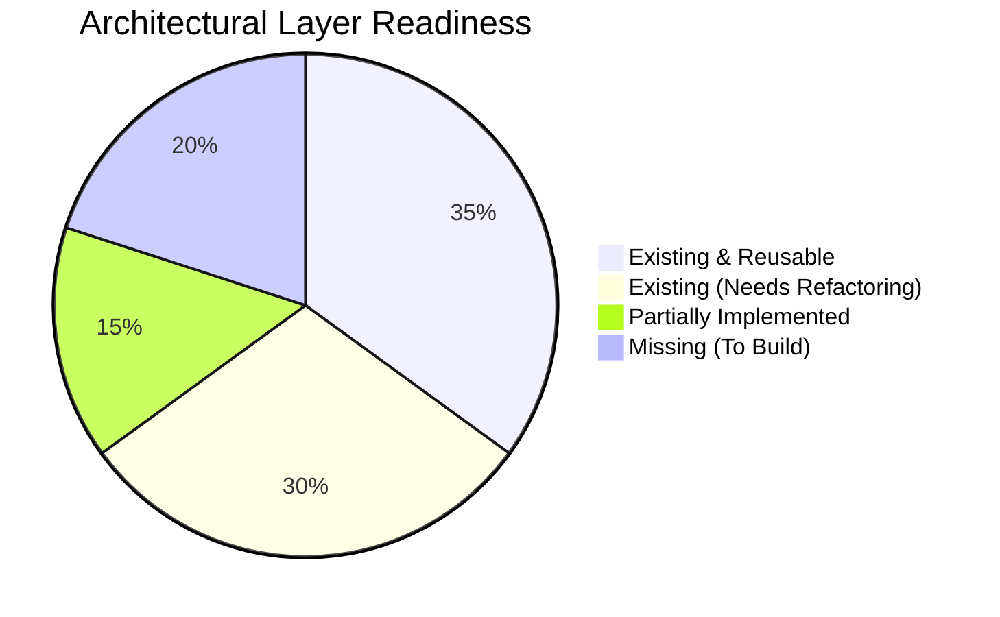

# GHOST ARCHITECTURE GAP ANALYSIS
**Document:** `ARCHITECTURE_GAP_ANALYSIS.md`  
**Status:** EVIDENCE-BASED SUBSYSTEM AUDIT & GAP MATRIX  
**Version:** 1.0  
**Date:** 2026-11-10  
**Working Directory:** `/home/pranc/projects/ghost`  

---

## 1. Classification Methodology

Every subsystem and capability requested in the Universal Intelligence System mandate is evaluated against the ground-truth code in `src/ghost/` and assigned one of six statuses:

- **[A] Existing and Reusable:** Fully implemented, tested, and actively functional.
- **[B] Existing Requiring Refactoring:** Working logic exists but requires decoupling, modularization, or interface standardization.
- **[C] Partially Implemented:** Scaffolding, partial methods, or stubs exist without full end-to-end integration.
- **[D] Missing:** No implementation exists in the current repository; must be engineered from scratch.
- **[E] Experimental / Obsolete:** Prototype code that was abandoned, superseded, or no longer aligned with architecture.
- **[F] Requiring Investigation:** External integrations or hardware dependencies requiring verification on host OS.

---

## 2. Seven Intelligence Domains — Gap Matrix

| Intelligence Domain | Mandated Capabilities | Existing Code Location | Current Classification | Gap & Implementation Action Required |
|---|---|---|---|---|
| **1. System Intelligence** | CPU/RAM/GPU monitoring, temperature, bottlenecks, crash recovery, process watch | `watchdog/service.py`, `autonomy/scheduler.py` (`TelemetryProvider`) | **[C] Partially Implemented** | Existing watchdog collects basic heartbeats and CRM counts. Missing: deterministic procfs/NVML hardware collector for CPU/RAM/GPU temp and bottleneck anomaly detector. |
| **2. Development Intelligence** | Git repo monitor, code change detection, build/test monitoring, bug investigation, verification | `control/fixers.py`, `control/fixer_worker.py`, `control/sidecars.py` | **[B] Existing Requiring Refactoring** | P7 fixers diagnose customer issues and run sidecars. Missing: continuous local Git repo watcher, build/test error listener, and dev agent contract. |
| **3. Research Intelligence** | Web recon, OSS discovery, technology tracking, competitor research, source provenance, dossiers | `workers/recon_scout.py`, `workers/source_ledger.py`, `workers/dossier.py`, `mcp/bridge.py` | **[A] Existing and Reusable** | Rock-solid Brave CDP scraper, Google Maps recon, SHA-256 provenance tracking, and dossier generators already fully functional and tested. |
| **4. Personal Intelligence** | Persistent context, operator objectives, task scheduling, reminders, daily briefings | `core/memory.py` (`CoreMemoryStore`), `core/follow.py`, `autonomy/digest.py` | **[B] Existing Requiring Refactoring** | 3-layer memory with contradiction resolution is functional. Daily digest runs at 09:00. Missing: formal Objective lifecycle and unfinished work patrol. |
| **5. Physical Intelligence** | Smart-home, MQTT, Home Assistant, sensor monitoring, readback state verification | *None* | **[D] Missing** | Zero smart-home code exists. Requires: `collectors/homeassistant.py`, MQTT client, and physical state readback verifier. |
| **6. Business Intelligence** | Lead hunting, qualification, CRM, proposal preparation, demo building, outreach | `workers/lead_hunter.py`, `workers/demo_state_machine.py`, `workers/deal_closer.py`, `crm/db.py` | **[A] Existing and Reusable** | Fully mature 5-stage luxury demo generator, Section Kit, Vercel deployer, Next.js production exporter, and CRM database. |
| **7. Creative Intelligence** | Parametric CAD, OpenSCAD, Blender, UI/UX design, website generation, geometry validation | `workers/section_kit.py`, `workers/export_demo_to_production.py`, `workers/three_site_builder.py` | **[C] Partially Implemented** | Web design and Next.js exporting are production-grade. CAD/OpenSCAD/Blender integrations are completely missing. |

---

## 3. Nine Architectural Layers — Gap Matrix

### Layer 1: Perception & Event Collection
- **Current State:** Ad-hoc collectors exist in `watchdog/service.py` (polling heartbeats) and `autonomy/intake.py` (polling IMAP email).
- **Classification:** **[C] Partially Implemented**
- **Gap:** Collectors are tightly coupled to individual service loops. Requires a unified `src/ghost/collectors/` package with fault-isolated collectors for Hardware (`SystemCollector`), Git (`GitCollector`), and Applications.

### Layer 2: Structured Event Infrastructure (`EventBus`)
- **Current State:** `data/events.db` stores raw signal strings via `AutonomousWatchdog._record_signal()`.
- **Classification:** **[B] Existing Requiring Refactoring**
- **Gap:** Existing event storage lacks typed schemas, severity enums, UUIDv7 correlation IDs, and in-memory asynchronous pub/sub routing with subscriber fault isolation.

### Layer 3: Unified Shared State (`SystemStateManager`)
- **Current State:** State is fragmented across `data/heartbeat.json`, `data/rhythm/`, `data/crm.db`, and `configs/session_state.json`.
- **Classification:** **[B] Existing Requiring Refactoring**
- **Gap:** No centralized in-memory thread-safe state coordinator providing instantaneous snapshots of hardware, active tasks, running agents, and active windows.

### Layer 4: Intelligence & Decision Engine
- **Current State:** `OmniRouteBrain` handles LLM generation; `PolicyEngine` evaluates static JSON bounds.
- **Classification:** **[A] Existing and Reusable**
- **Gap:** Priority decisions currently rely either on static schedules or full LLM turns. Requires a deterministic **Event Priority Engine** to filter routine noise before calling the LLM.

### Layer 5: Central Orchestrator & Task State Machine
- **Current State:** `JobQueue` in `core/jobqueue.py` implements a durable SQLite task lease/retry mechanism (`pending`, `claimed`, `done`, `dead`). `Mission` in `core/mission.py` tracks multi-step tasks.
- **Classification:** **[B] Existing Requiring Refactoring**
- **Gap:** `JobQueue` and `MissionTracker` are distinct subsystems. Need to unify them under the standard 11-state task lifecycle (`CREATED` through `WAITING_FOR_APPROVAL`).

### Layer 6: Specialized Agent Suite
- **Current State:** Single `GhostAgent` with modular workers (`DemoBuilderWorker`, `LeadHunter`, `DealCloser`, `FixerWorker`).
- **Classification:** **[B] Existing Requiring Refactoring**
- **Gap:** Workers exist as utility classes rather than standardized agents conforming to an `AgentContract` (defining input/output schemas, timeouts, and required permissions).

### Layer 7: Tool Registry & Execution
- **Current State:** 14 tools hardcoded in `OmniRouteBrain.get_tools()` and dispatched in a massive `elif` chain in `execute_tool()`.
- **Classification:** **[B] Existing Requiring Refactoring**
- **Gap:** `execute_tool()` is 2,600+ lines in `brain.py`. Must be extracted into a declarative `ToolRegistry` where each tool is registered with permissions, side-effect annotations, and verification hooks.

### Layer 8: Memory & Knowledge Architecture
- **Current State:** Working Context (`conversation_history.json`), Episodic Memory (`ghost.db`), Core Directives (`directives.json` with contradiction detection).
- **Classification:** **[A] Existing and Reusable**
- **Gap:** Excellent foundation. Missing explicit Semantic Memory (document chunk retrieval) and Objective Memory (long-term goal tracker).

### Layer 9: Independent Verification
- **Current State:** Visual QA Gate in `deploy.py` (fail-closed check on real screenshots) and Claims Linter in `claims_lint.py`.
- **Classification:** **[A] Existing and Reusable**
- **Gap:** Verification is well-proven for demos and deploys. Needs extension to Git code changes (automated test verification) and physical smart-home commands (telemetry readback).

---

## 4. Prioritized Architectural Work Packages

1. **Package 1 (Foundation):** Structured Event Infrastructure (`core/events.py`) + Shared System State Manager (`core/system_state.py`) + Deterministic Hardware Telemetry Collector (`collectors/system_collector.py`).
2. **Package 2 (Orchestration):** Unified Tool Registry (`core/tool_registry.py`) extracted from `brain.py` + Standardized Task State Machine (`core/task_orchestrator.py`).
3. **Package 3 (Agent Contracts):** Common `AgentContract` base class + System Agent + Development Agent (`agents/dev_agent.py` monitoring Git/tests).
4. **Package 4 (Packaging & Hygiene):** Add missing dependencies (`openai`, `sympy`, `pillow`) to `requirements.txt`, create root `README.md`, untrack `data/` snapshots from git.
