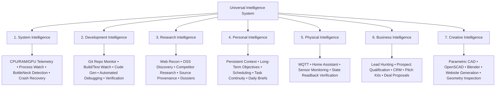

# GHOST TARGET ARCHITECTURE SPECIFICATION
## Universal Intelligence System — Target Blueprint
**Document:** `ARCHITECTURE_TARGET.md`  
**Status:** AUTHORITATIVE TARGET BLUEPRINT  
**Version:** 2.0  
**Date:** 2026-11-10  
**Target Hardware:** Arch Linux, ~8 GB RAM, NVIDIA GTX 1650 Mobile (4 GB VRAM), Hyprland/Wayland  

---

## 1. Executive Vision

GHOST is an autonomous, universal operating intelligence designed to continuously perceive its digital and physical environment, maintain persistent situational awareness, reason across short- and long-term objectives, coordinate specialized domain agents, execute deterministic and model-assisted actions through real tools, and independently verify real-world outcomes.

The conversational chat interface and voice HUD are merely observation and command conduits; the actual product is the underlying perception, state, orchestration, memory, and verification engine.

---

## 2. The Seven Intelligence Domains



### 2.1 System Intelligence
- **Continuous Environment Perception:** Non-LLM deterministic collectors sample CPU, RAM, disk I/O, network bandwidth, process states, and NVIDIA GPU temperature/VRAM/utilization every 10–30s.
- **Pattern & Context Awareness:** Distinguishes between transient bursts (e.g. compiling a test or rendering audio) and persistent resource anomalies (e.g. 90% CPU while ostensibly idle).
- **Process & Agent Health:** Supervises internal GHOST background threads, MCP servers, and spawned subprocesses.

### 2.2 Development Intelligence
- **Repository Watcher:** Watches local Git repositories (`py-inotify` / `watchfiles`) for file changes, git branch switching, and unstaged modifications.
- **Automated Build & Test Watch:** Automatically captures build/test run failures, extracts error traces, and correlates failure logs to recent commits.
- **Assisted Bug Investigation:** Isolates regressions, stages minimal patches in sidecar sandboxes, runs verification suites, and submits pull-requests or operator proposals.

### 2.3 Research Intelligence
- **Autonomous Scrapers & Search:** Coordinates Brave CDP and search engines to discover open-source libraries, technical benchmarks, and market signals.
- **Strict Provenance Doctrine:** Every fact, quote, and artifact maintains cryptographic hash provenance (`sha256`) and source URL citations (`SOURCES.json`).
- **Dossier Compilation:** Structures gathered research into Markdown dossiers and Obsidian-compatible knowledge vaults.

### 2.4 Personal Intelligence
- **Operator Context Persistence:** Maintains active awareness of the operator's preferences, active projects, work schedules, and pending commitments.
- **3-Layer Memory Integration:** Surfaces pertinent facts and active directives without polluting LLM token budgets.
- **Unfinished Work Patrol:** Detects abandoned tasks or unverified objectives and schedules non-intrusive reminders during morning/evening briefings.

### 2.5 Physical Intelligence
- **Smart-Home Bus:** Connects via MQTT and Home Assistant REST/WebSocket APIs.
- **Sensor Telemetry:** Monitors ambient temperature, power draw, smart plugs, and lighting states.
- **Physical Readback Verification:** Confirms state transitions by reading device telemetry back from the bus after commanding changes (command != confirmation).

### 2.6 Business Intelligence
- **Autonomous Agency Engine (Existing Core Strength):** Identifies prospective high-ticket local clients, qualifies website absence/deficiencies, scrapes authentic venue photography, and scaffolds luxury single-page demos.
- **Closing & CRM Pipeline:** Tracks leads through qualification, proposal, contract signing, invoice generation (UPI/Razorpay collect-only), and post-onboarding site maintenance.

### 2.7 Creative Intelligence
- **Parametric CAD:** Scripting with OpenSCAD and Blender Python API for procedural 3D generation.
- **Design & UI Generation:** Section Kit component composition and Next.js App Router codebase exporting.
- **Geometry & Visual Verification:** Headless rendering and visual diff inspection to verify visual and structural criteria.

---

## 3. The Nine Architectural Layers

```
┌────────────────────────────────────────────────────────────────────────┐
│ Layer 9: INDEPENDENT VERIFICATION                                      │
│ Fail-closed outcome verification (Screenshots, Test Runs, State Readback)│
├────────────────────────────────────────────────────────────────────────┤
│ Layer 8: MEMORY & KNOWLEDGE                                            │
│ Working Context • Episodic SQLite • Core Facts • Semantic Vault        │
├────────────────────────────────────────────────────────────────────────┤
│ Layer 7: TOOL REGISTRY & EXECUTION                                     │
│ Declarative Schemas • Single-Use HMAC Grants • Isolated Workers        │
├────────────────────────────────────────────────────────────────────────┤
│ Layer 6: SPECIALIZED AGENT SUITE                                       │
│ System • Dev • Research • Personal • Physical • Business • Creative    │
├────────────────────────────────────────────────────────────────────────┤
│ Layer 5: CENTRAL ORCHESTRATOR                                          │
│ Objective LifeCycle • Task State Machine • Concurrency & Priority      │
├────────────────────────────────────────────────────────────────────────┤
│ Layer 4: INTELLIGENCE & DECISION ENGINE                                │
│ Deterministic Priority Engine • OmniRoute Cloud Model Gateway          │
├────────────────────────────────────────────────────────────────────────┤
│ Layer 3: UNIFIED SHARED STATE                                          │
│ Real-Time Telemetry Snapshot • Active Tasks • Running Agents • Devices │
├────────────────────────────────────────────────────────────────────────┤
│ Layer 2: STRUCTURED EVENT INFRASTRUCTURE (EventBus)                    │
│ Typed Events • Deduplication • SQLite WAL Persistence • Dead-Letter    │
├────────────────────────────────────────────────────────────────────────┤
│ Layer 1: PERCEPTION & EVENT COLLECTION                                 │
│ Hardware Sensors • Hyprland Desktop • Git Watcher • IMAP • Network     │
└────────────────────────────────────────────────────────────────────────┘
```

### Layer 1: Perception & Event Collection
- Lightweight, fault-isolated asynchronous collectors.
- A crash in one collector (e.g. MQTT offline) never halts system telemetry or user chat.

### Layer 2: Structured Event Infrastructure (`EventBus`)
- Every event conforms to a strict data contract:
  ```python
  class Event:
      event_id: str               # UUIDv7 (time-ordered)
      event_type: str             # e.g., "system.telemetry.sample", "git.commit.detected"
      source: str                 # e.g., "collector.hardware", "collector.git"
      timestamp: float            # Epoch timestamp
      severity: EventSeverity     # DEBUG, INFO, WARNING, ERROR, CRITICAL
      payload: Dict[str, Any]     # Validated structured payload
      correlation_id: Optional[str] # Tracing across causal chains
      provenance: Optional[str]   # Origin metadata (file path, URL, device ID)
      dedup_id: Optional[str]     # Hash for idempotent deduplication
  ```
- Events are logged to SQLite WAL backing tables (`events_v2`) and distributed to subscribers in memory with subscriber isolation (subscriber errors are caught and logged without affecting peers).

### Layer 3: Shared State (`SystemStateManager`)
- Maintains a thread-safe, in-memory live snapshot of:
  - Hardware vitals (CPU, RAM, GPU utilization, temperature).
  - Desktop status (active Hyprland workspace, focused window title).
  - Agent statuses (active workers, lease times).
  - Task board states.
  - Integration connectivity (OmniRoute, Home Assistant, Brave CDP).

### Layer 4: Intelligence & Decision Engine
- **Deterministic Priority Engine:** Evaluates events using a rule matrix (severity, frequency, objective relevance, duration) to filter out noise without touching an LLM.
- **OmniRoute Model Gateway:** Directs complex reasoning, planning, and drafting tasks to cloud model tiers (`antigravity/gemini-3.8-flash-low`). Zero local model subprocesses.

### Layer 5: Central Orchestrator & Task State Machine
- Manages high-level **Objectives** and low-level **Tasks**.
- Supported 11 Task States:
  ```
  [CREATED] ──> [PLANNED] ──> [QUEUED] ──> [RUNNING] ──> [VERIFYING] ──> [COMPLETED]
                   │             │           │               │
                   ▼             ▼           ▼               ▼
               [BLOCKED]     [CANCELLED]  [RETRYING]     [FAILED]
                                             │
                                             ▼
                                  [WAITING_FOR_APPROVAL]
  ```

### Layer 6: Specialized Agent Contract
Every domain agent implements the common interface:
```python
class AgentContract(ABC):
    agent_id: str
    name: str
    responsibility: str
    required_permissions: List[str]

    @abstractmethod
    async def plan_task(self, objective: Objective) -> List[Task]: ...

    @abstractmethod
    async def execute_task(self, task: Task, context: TaskContext) -> TaskResult: ...

    @abstractmethod
    async def verify_result(self, task: Task, result: TaskResult) -> VerificationEvidence: ...
```

### Layer 7: Unified Tool Registry & Execution
- All tools declare parameter JSON schemas, required permission levels, side-effect flags, and verification methods.
- Side-effect tools require single-use HMAC capability tokens (`authority/protocol.py`).

### Layer 8: 6-Tier Memory Architecture
1. **Working Memory:** Recent conversation buffer (< 4k tokens).
2. **Episodic Memory:** Chronological SQLite logs of executed tasks, tool results, and outcomes.
3. **Semantic Memory:** Tagged knowledge base and domain facts.
4. **Procedural Memory:** Reusable execution workflows and playbooks.
5. **Project Memory:** Active client dossiers, codebases, and assets.
6. **Objective Memory:** Long-term active goals, milestones, and progress metrics.

### Layer 9: Independent Verification
- Execution and verification are decoupled.
- An agent that generates a file, deploys a site, or triggers an MQTT switch cannot verify its own success; a dedicated verification procedure (e.g. DOM inspection, screenshot capture, readback state) must inspect the resulting artifact.

### Layer 10: Central Intelligence, Deterministic Task Routing & Context Isolation
- **Centralized Intelligence Coordinator:** Central GHOST remains the primary user conversational interface without prompt bloat. Receives a compact capability summary (< 400 tokens) rather than 54+ raw tool schemas.
- **Deterministic TaskRouter:** Programmatically routes requests to single-domain specialists or multi-stage composite workflows (`business_reconnaissance`, `dev_incident_investigation`, `focus_session_activation`, `creative_asset_pipeline`) without relying on probabilistic model recall.
- **Agent Capability Registry:** Programmatically indexes all 7 specialist domain agents with capability descriptors, supported task types, input/output schemas, verification criteria, and scoped tool IDs derived directly from `ToolRegistry`.
- **Context Isolation & Scoped Tools:** Specialist agents receive only authorized tools within their permission envelope. Detailed tool logs and execution traces remain isolated in the store; only structured `DelegationResult` summaries return to Central GHOST.
- **Typed Delegation Contracts:** Enforces `DelegationTaskContract` specifications with parent-child linkage, execution order, dependency resolution, and mandatory ground-truth `VerificationEvidence`.

### Layer 11: Input Integrity, Intent Categorization & Anti-Contamination
- **Zero Silent Truncation:** Complete, unadulterated user requests are preserved authoritatively in `InputPayload` dataclasses across the entire pipeline. No string slicing (`[:60]`, `[:70]`) is permitted on user instructions or objectives.
- **Incomplete Payload Detection:** Severed tokens, truncated words at string boundaries, and unclosed quotes/code blocks trigger immediate `TASK_CLARIFICATION` prompts rather than partial or hallucinated execution.
- **Strict Intent Boundary:** Inquiries asking what tools work or how a task could be done are classified as `CAPABILITY_QUERY` or `TASK_PLANNING` respectively, returning verified tool/agent statuses or dry-run execution outlines with zero task dispatches. Imperative execution requires explicit action directives.
- **Directive / Example Isolation:** Quoted passages, examples, and code blocks are isolated prior to intent and keyword evaluation.
- **Anti-Contamination Verification:** Stage outputs must demonstrate topic relevance to the delegation objective. Scavenging stale cached artifacts from disk (e.g. static demos or previous task dossiers) is rejected with `INVALID_DISPATCH`.

---

## 4. Hardware & Resource Budgeting (GTX 1650 / 8 GB RAM)

1. **Memory Budgeting:** Max resident set size (RSS) for Ghost core daemon capped at **1.5 GB RAM**.
2. **GPU Allocation:**
   - Kokoro TTS model loaded in ONNX runtime on CUDA (allocates ~600 MB VRAM).
   - If VRAM is constrained or driver missing, gracefully falls back to CPU INT8 execution.
3. **Zero Local LLM Execution:** All LLM inference strictly routed via OmniRoute cloud API to preserve CPU/RAM/VRAM for OS, Hyprland, and client preview applications.
4. **Concurrency Ceiling:** Max 2 concurrent background task workers; additional microjobs wait in SQLite `JobQueue`.
