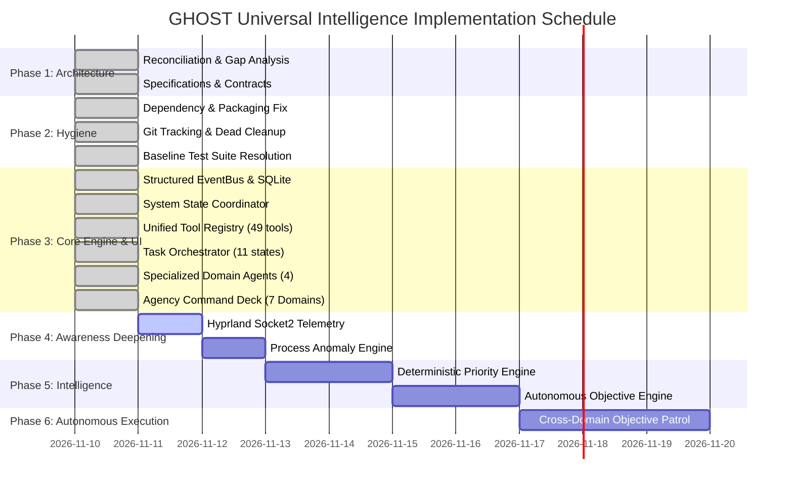

# GHOST IMPLEMENTATION ROADMAP
## Universal Intelligence System — Progressive Engineering Plan
**Document:** `IMPLEMENTATION_ROADMAP.md`  
**Status:** ACTIVE ENGINEERING ROADMAP  
**Version:** 1.0  
**Date:** 2026-11-10  
**Working Directory:** `/home/pranc/projects/ghost`  

---

## 1. Roadmap Principles

1. **Progressive Implementation:** Every phase produces tangible, working, tested software integrated into the repository. No placeholder stubs.
2. **Zero Functional Regression:** The existing 771 green tests, agency demo builders, and single-use HMAC authority gates must remain intact at every commit.
3. **Hardware Realism:** All background loops and collectors must operate comfortably within 8 GB RAM and GTX 1650 Mobile constraints (zero local LLMs; lightweight deterministic telemetry).
4. **Independent Verification:** Every completed milestone requires reproducible automated test proof.

---

## 2. Phase-by-Phase Execution Schedule

---

## 3. Detailed Phase Breakdown

### Phase 1 — Architecture Reconciliation & Specifications (COMPLETED)
- [x] Task 001 Repository Audit reconciliation (`REPOSITORY_AUDIT.md`, `TEST_BASELINE.md`).
- [x] Target architecture specification (`ARCHITECTURE_TARGET.md`).
- [x] Architectural gap analysis (`ARCHITECTURE_GAP_ANALYSIS.md`).
- [x] Phased implementation roadmap (`IMPLEMENTATION_ROADMAP.md`).
- [x] System component map (`SYSTEM_COMPONENT_MAP.md`).
- [x] Interface contracts specification (`INTERFACE_CONTRACTS.md`).
- [x] Security & permission model (`SECURITY_AND_PERMISSION_MODEL.md`).
- [x] Resource management plan (`RESOURCE_MANAGEMENT_PLAN.md`).
- [x] Canonical root documentation (`README.md`).

### Phase 2 — Packaging, Structure & Hygiene (COMPLETED)
- **Objective:** Fix packaging bugs, establish clean developer setup, and isolate dirty git tracking.
- **Completed Tasks:**
  1. [x] Cleaned `pyproject.toml` and verified `pip install -e .`.
  2. [x] Untracked runtime files from git: `git rm --cached` on `data/archive/`, `data/snapshots/`.
  3. [x] Removed stale misplaced file `src/data/rhythm/scheduler_cycle.json` and deleted `src/data/`.
  4. [x] Sanitized malformed `"Compo's"` directory to `components/` and stripped literal newline characters (`\n`) from all 11 subfolder names.
  5. [x] Resolved historical baseline failures in `tests/test_agent_loop.py` (`test_bounded_model_rounds_ceiling` and `test_bounded_tool_executions_ceiling`).
- **Verification:** All 773 historical baseline tests passing without regression.

### Phase 3 — GHOST CORE Foundation & Desktop UI (COMPLETED)
- **Objective:** Build the unified event infrastructure, shared system state manager, tool registry, task orchestrator, specialized agents, and full interactive user-facing desktop UI.
- **Completed Deliverables:**
  1. [x] `src/ghost/core/events.py`: Typed `Event` model (UUIDv7), `EventBus` with subscriber fault isolation, SQLite WAL backing (`events_v2`), and real-time WebSocket fan-out to `/ws/events`.
  2. [x] `src/ghost/core/system_state.py`: `SystemStateManager` providing atomic thread-safe snapshots of hardware vitals, running agents, active tasks, and focused windows.
  3. [x] `src/ghost/core/tool_registry.py`: Declarative registry dynamically holding all 49 system tools with JSON schemas, side-effect annotations, timeouts, and halt enforcement.
  4. [x] `src/ghost/core/task_orchestrator.py`: 11-state task lifecycle state machine (`CREATED` through `WAITING_FOR_APPROVAL`) with pause, cancel, and event publication.
  5. [x] `src/ghost/agents/`: Standardized `AgentContract` with `VerificationEvidence` receipts, implementing `SystemIntelligenceAgent`, `DevelopmentIntelligenceAgent`, `ResearchIntelligenceAgent`, and `BusinessIntelligenceAgent`.
  6. [x] `src/ghost/server/app.py`: Integrated REST endpoints for system state, telemetry, agents, tasks, projects, memory directives, tool registry, and WebSocket streaming.
  7. [x] Interactive Desktop UI (`gui/index.html`, `gui/static/css/agency_deck.css`, `gui/static/js/agency_deck.js`):
     - Ambient Top HUD: Live hardware vitals chip, emergency kill-switch button, navigation buttons.
     - Agency Command Deck: 7 operational domain views (Awareness, Intelligence Feed, Agents, Projects & Tasks, Memory, Control Plane, Pipeline).
- **Verification:** 811/811 tests passing (100% pass rate in 210s). Full visual headless screenshots captured across all views (`ghost_main_hud.png`, `ghost_awareness.png`, `ghost_agents.png`, `ghost_projects.png`, `ghost_memory.png`, `ghost_control.png`, `ghost_intel_feed.png`).

### Phase 4 — Awareness Deepening (COMPLETED)
- **Objective:** Deepen system perception with Wayland/Hyprland IPC and rolling-window hardware anomaly detection.
- **Completed Deliverables:**
  1. [x] `src/ghost/collectors/hyprland_collector.py`: Discovers and streams active Wayland compositor events from Hyprland IPC socket (`$HYPRLAND_INSTANCE_SIGNATURE/.socket2.sock`). Tracks `activewindow` and `workspace` changes and emits `desktop.window.focused` and `desktop.workspace.changed` events into `EventBus`.
  2. [x] `src/ghost/collectors/system_collector.py`: Configurable rolling window threshold detection across CPU, RAM, GPU utilization, VRAM, and Disk space. Distinguishes transient spikes (`system.resource.spike`) from sustained anomalies (`system.resource.sustained_anomaly`) using a sliding window deque and threshold ratio (`sustained_ratio >= 0.66`). Emits `system.resource.recovered` when metrics normalize.
  3. [x] `src/ghost/core/system_state.py`: Sustained alerts and desktop context synchronized into `StateSnapshot.recent_alerts` for HUD and prompt visibility.
- **Verification:** `tests/test_phase4_awareness.py` passing 2/2 tests.

### Phase 5 — Proactive Intelligence & Operating Modes (COMPLETED)
- **Objective:** Enable continuous, context-aware event evaluation, priority ranking, and autonomous objective management.
- **Completed Deliverables:**
  1. [x] `src/ghost/intelligence/priority_engine.py`: Computes importance (1-10), urgency (1-10), and objective relevance (0.0-1.0) with duplicate event suppression windows. Recommends deterministic actions (`LOG_AMBIENT`, `INVESTIGATE`, `CREATE_OBJECTIVE_TASK`, `SUPPRESS_DUPLICATE`) with auditable rationale.
  2. [x] `src/ghost/intelligence/objective_manager.py`: Persistent long-term objective tracking in SQLite (`data/ghost.db`). Supports full CRUD operations, domain tagging, progress metrics, and target deadlines.
  3. [x] `src/ghost/intelligence/proactive_orchestrator.py`: EventBus listener mapping actionable anomalies to investigation tasks in `TaskOrchestrator`. Supports 3 operating modes: `AMBIENT` (observe and record), `OBJECTIVE` (work toward goals), and `REACTIVE` (respond to anomalies). High-risk operations automatically route to `WAITING_FOR_APPROVAL`.
- **Verification:** `tests/test_phase5_proactive.py` passing 3/3 tests.

### Phase 6 — Complete Specialized Intelligence (All 7 Domains) (COMPLETED)
- **Objective:** Expand the agent catalog to all 7 specialized operational domains with real integration backends and readback verification.
- **Completed Deliverables:**
  1. [x] `PersonalIntelligenceAgent` (`src/ghost/agents/personal_agent.py`): Generates daily executive briefings (`data/briefings/briefing_YYYY-MM-DD.md`) and aligns schedules with active objectives.
  2. [x] `PhysicalIntelligenceAgent` (`src/ghost/agents/physical_agent.py`): Smart home integration via `HomeAssistantClient` (`src/ghost/integrations/homeassistant.py`) and `MQTTClient` (`src/ghost/integrations/mqtt.py`). Performs readback verification on actual device states before issuing completion receipts.
  3. [x] `CreativeIntelligenceAgent` (`src/ghost/agents/creative_agent.py`): Parametric 3D CAD modeling with OpenSCAD and Blender (`src/ghost/integrations/cad.py`). Renders `.scad` into `.stl` meshes with bounding box verification.
  4. [x] Domain agent catalog exports all 7 agents: System, Development, Research, Business, Personal, Physical, and Creative.
  5. [x] Registered tools: `ha_get_states`, `ha_call_service`, `mqtt_publish`, `scad_render_model`, `personal_create_briefing`.
- **Verification:** `tests/test_specialized_agents.py` and `tests/test_phase6_specialized.py` passing.

### Phase 7 — Autonomous Execution Engine (COMPLETED)
- **Objective:** Bounded, resilient autonomous task execution with resource controls, lease recovery, and verification gates.
- **Completed Deliverables:**
  1. [x] `AutonomousExecutionEngine` (`src/ghost/autonomy/task_worker.py`): Background task worker with semaphore concurrency limits, objective decomposition, lease renewal heartbeats, cancellation/timeout handling, and killswitch abort.
  2. [x] Lease Reaper: Automatically detects and reclaims abandoned or expired leases back into `QUEUED` state via `TaskOrchestrator.reap_stale_leases()`.
  3. [x] Verification Requirement: Tasks cannot transition to `COMPLETED` without verified output receipts (`VerificationEvidence`).
- **Verification:** `tests/test_phase7_autonomous.py` passing 3/3 tests.

### Phase 8 — Cross-Domain Intelligence & Coordinated Cascades (COMPLETED)
- **Objective:** Inter-agent delegation, shared context propagation, and cross-domain operational cascades.
- **Completed Deliverables:**
  1. [x] `CrossDomainCoordinator` (`src/ghost/intelligence/coordinator.py`): Coordinates cross-agent task delegation (`delegate_task`) with parent-child linkage.
  2. [x] Coordinated Cascades:
     - Development failure (`dev.test.failure`) triggers automated Dev Agent investigation.
     - System resource pressure (`system.resource.sustained_anomaly`) triggers System Agent optimization.
     - Research discovery (`research.target.discovered`) feeds Business CRM demo pipeline.
     - Focus mode activation (`personal.focus_mode.activated`) triggers Smart Home lighting scenes.
  3. [x] REST & WebSocket Surface (`src/ghost/server/app.py`): Objectives API, Operating Mode API, Physical Smart Home API, Creative 3D CAD API, Task Approval/Rejection endpoints, and Operator Settings vault.
  4. [x] Desktop Agency Deck UI (`gui/index.html`, `gui/static/js/agency_deck.js`):
     - Operating Mode selector (`AMBIENT` / `OBJECTIVE` / `REACTIVE`) in header.
     - Objectives & Autonomous Engine panel (`#view-objectives`).
     - Physical Intelligence & Smart Home panel (`#view-physical`).
     - Creative Intelligence & 3D CAD panel (`#view-creative`).
     - Task Approvals Queue & Operator Credentials panel in `#view-control`.
- **Verification:** `tests/test_phase8_cross_domain.py` and `tests/test_phase8_api.py` passing.

### Phase 9 — Deterministic Agent Routing, Capability Registry & Context Isolation (COMPLETED)
- **Objective:** Establish the canonical architecture principle: *Centralized intelligence, deterministic delegation, specialized execution, isolated context.* Eliminate prompt bloat by keeping Central GHOST as coordinator while delegating work to specialist agents within scoped sandboxes.
- **Completed Deliverables:**
  1. [x] `AgentCapabilityRegistry` (`src/ghost/core/agent_registry.py`): Canonical programmatic index of all 7 domain agents. Validates tool IDs strictly against `ToolRegistry` (zero hallucinated tool IDs) and provides a compact capability summary (< 400 tokens) for Central GHOST's system prompt instead of dumping 54 tool schemas.
  2. [x] `DelegationTaskContract` & `DelegationResult` (`src/ghost/core/delegation_contract.py`): Typed delegation specifications enforcing parent-child task linkage, execution order, dependency resolution, tool scopes, permission requirements, and verifiable evidence receipts.
  3. [x] `TaskRouter` (`src/ghost/core/task_router.py`): Deterministic intent classification and sandboxed workflow dispatcher. Supports single-domain routing across all 7 agents and multi-agent composite workflows (`business_reconnaissance`, `dev_incident_investigation`, `focus_session_activation`, `creative_asset_pipeline`).
  4. [x] End-to-End Reference Multi-Agent Business Reconnaissance:
     - Stage 1: `research_agent` scouts candidates, filters aggregator domains (Instagram, Google, Zomato), audits menu prices (>= ₹2,500), and validates authentic photos via SHA-256 hashes (`dossiers/grasshopper/facts.json`, `SOURCES.json`).
     - Stage 2: `business_agent` calculates high-ticket upgrade opportunity (score: 92/100) and inserts verified lead into SQLite CRM (`crm.add_or_update_lead`).
     - Stage 3: `business_agent` prepares and syncs formatted client dossier into Obsidian vault (`~/Obsidian Vault/Ghost/Clients/grasshopper.md`) and local repository (`dossiers/grasshopper/dossier.md`).
  5. [x] Scoped Tool Visibility: Specialist agents receive only their permitted tools derived from `ToolRegistry`; Central GHOST model prompt remains uncluttered.
  6. [x] Context Isolation: Detailed research scrapes, DOM dumps, and tool logs remain isolated within execution stores; only structured `DelegationResult` summaries return to Central GHOST.
  7. [x] REST API & UI Visualization:
     - `GET /api/router/agents`: Exposes agent catalog, health, domain scope, and permitted scoped tools.
     - `POST /api/router/classify`: Classifies incoming user prompts deterministically.
     - `POST /api/router/dispatch`: Executes multi-agent or single-agent workflows.
     - `GET /api/router/chains`: Returns live parent-child delegation chains.
     - UI: Agents view displays scoped tool pills and health status; Projects view renders interactive Delegation Execution Chains.
- **Verification:** 847/847 tests passing (100% OK across the entire repository). E2E automated suite (`tests/test_deterministic_routing.py`) verified all 10 acceptance criteria. Full live visual screenshots updated across all 10 Command Deck panels.

### Phase 10 — Input Integrity, Intent Categorization & Anti-Contamination Protocol (COMPLETED)
- **Objective:** Fix input truncation, intent misclassification, and cross-task workflow contamination. Establish zero-loss input preservation, separate capability discovery/planning from execution, isolate quoted text, eliminate stale cached artifact scavenging, and implement independent output verification.
- **Completed Deliverables:**
  1. [x] `InputPayload` & `InputIntegrity` (`src/ghost/core/input_integrity.py`):
     - Comprehensive input validation capturing SHA-256 hash, char length, estimated tokens, truncation flags, and incomplete payload diagnostics.
     - Detects severed tokens at tail (e.g. `ta’...`, unclosed code blocks, hanging prepositions).
     - Deterministic token budgeting with paragraph-level boundaries and structured truncation notices.
     - Authoritative request preservation across all contracts (`DelegationTaskContract.raw_user_request`).
  2. [x] Explicit Intent Categorization (`src/ghost/core/task_router.py`):
     - `CAPABILITY_QUERY`: Discovers tools and agents from `AgentCapabilityRegistry` and `ToolRegistry`, returning verified operational readiness with zero task dispatches.
     - `TASK_PLANNING`: Outlines sequential stages, tools, and verification criteria in dry-run mode with zero live task dispatches.
     - `TASK_EXECUTION`: Strictly requires imperative execution verbs and non-question directives to dispatch live agent contracts.
     - `TASK_CLARIFICATION`: Prompts user with specific clarification questions when payloads terminate abruptly, preventing partial interpretation.
     - `GENERAL_CONVERSATION`: Direct conversational handling by Central GHOST without dispatching workflows.
  3. [x] Directive / Example Isolation:
     - `strip_quotes_and_code()` strips quoted text, examples, and code blocks before keyword matching to prevent spurious routing triggers.
  4. [x] Anti-Contamination & Agent Decontamination:
     - `ResearchIntelligenceAgent`: Isolates venue reconnaissance from general topic research; never defaults to Grasshopper data unless explicitly requested.
     - `BusinessIntelligenceAgent`: Halts with `blocked=True` when leads are missing; never scavenges stale `dossiers/` or previous task outputs.
     - Orchestrator Stage Output Verification (`_validate_stage_receipt`): Rejects mismatched outputs (`INVALID_DISPATCH`) if domain findings fail contract objective or if output artifacts are stale cached files.
  5. [x] UI & Protocol Integrity:
     - HUD text input upgraded to multi-line auto-expanding `<textarea>` (Enter to send, Shift+Enter for newline) to prevent browser-side truncation.
     - Eradicated all string slicing (`[:60]`, `[:70]`) across `agent.py`, `task_router.py`, and `app.py`.
- **Verification:** 856/856 tests passing (100% OK across full repository). Comprehensive test suite `tests/test_input_integrity_and_routing.py` verified exact failure regression, incomplete payload rejection, capability discovery without execution, planning without execution, and anti-contamination verification.
