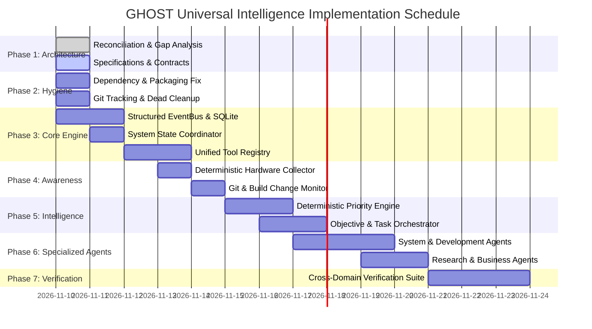

# GHOST IMPLEMENTATION ROADMAP
## Universal Intelligence System — Progressive Engineering Plan
**Document:** `IMPLEMENTATION_ROADMAP.md`  
**Status:** ACTIVE ENGINEERING ROADMAP  
**Version:** 1.0  
**Date:** 2026-11-10  
**Working Directory:** `/home/pranc/projects/ghost`  

---

## 1. Roadmap Principles

1. **Progressive Implementation:** Every phase produces tangible, working, tested software integrated into the repository. No placeholder stubs.
2. **Zero Functional Regression:** The existing 771 green tests, agency demo builders, and single-use HMAC authority gates must remain intact at every commit.
3. **Hardware Realism:** All background loops and collectors must operate comfortably within 8 GB RAM and GTX 1650 Mobile constraints (zero local LLMs; lightweight deterministic telemetry).
4. **Independent Verification:** Every completed milestone requires reproducible automated test proof.

---

## 2. Phase-by-Phase Execution Schedule

---

## 3. Detailed Phase Breakdown

### Phase 1 — Architecture Reconciliation & Specifications (IN PROGRESS)
- [x] Task 001 Repository Audit reconciliation (`REPOSITORY_AUDIT.md`, `TEST_BASELINE.md`).
- [x] Target architecture specification (`ARCHITECTURE_TARGET.md`).
- [x] Architectural gap analysis (`ARCHITECTURE_GAP_ANALYSIS.md`).
- [x] Phased implementation roadmap (`IMPLEMENTATION_ROADMAP.md`).
- [ ] System component map (`SYSTEM_COMPONENT_MAP.md`).
- [ ] Interface contracts specification (`INTERFACE_CONTRACTS.md`).
- [ ] Security & permission model (`SECURITY_AND_PERMISSION_MODEL.md`).
- [ ] Resource management plan (`RESOURCE_MANAGEMENT_PLAN.md`).
- [ ] Canonical root documentation (`README.md`).

### Phase 2 — Packaging, Structure & Hygiene
- **Objective:** Fix packaging bugs, establish clean developer setup, and isolate dirty git tracking.
- **Tasks:**
  1. Add missing dependencies to `requirements.txt`: `openai>=1.40.0`, `sympy>=1.13.0`, `pillow>=10.0.0`.
  2. Clean `pyproject.toml`: remove unused `fury-sdk` and link to root `README.md`.
  3. Untrack runtime files from git: `git rm --cached` on `data/archive/`, `data/snapshots/`, `data/heartbeat.json`, `data/rhythm/scheduler_cycle.json`.
  4. Move misplaced `src/data/rhythm/scheduler_cycle.json` to `data/rhythm/`.
  5. Delete empty dead skeleton `src/rose/`.
  6. Sanitize `Compo's/` directory name to `components/` and strip newline characters from subfolder names.
- **Acceptance Criteria:** `pip install -e .` succeeds in clean virtualenv; `git status` shows clean working tree with zero untracked runtime churn.

### Phase 3 — GHOST CORE Foundation (Immediate Engineering Priority)
- **Objective:** Build the unified event infrastructure, shared system state manager, and tool registry.
- **Deliverables:**
  1. `src/ghost/core/events.py`:
     - Typed `Event` model (UUIDv7, timestamp, severity, payload, correlation_id, provenance, dedup_id).
     - `EventBus` with async pub/sub, in-memory dispatch, subscriber fault isolation, and SQLite WAL backing in `ghost.db`.
  2. `src/ghost/core/system_state.py`:
     - `SystemStateManager` providing thread-safe snapshots of system vitals, active tasks, running agents, and active desktop windows.
  3. `src/ghost/core/tool_registry.py`:
     - Declarative tool registry extracting 14 hardcoded schemas and execution handlers from monolithic `brain.py`.
  4. `src/ghost/core/task_orchestrator.py`:
     - Unified 11-state task life cycle machine (`CREATED`, `PLANNED`, `QUEUED`, `RUNNING`, `VERIFYING`, `COMPLETED`, `FAILED`, `BLOCKED`, `CANCELLED`, `RETRYING`, `WAITING_FOR_APPROVAL`).
- **Acceptance Criteria:** Unit tests in `tests/test_universal_events.py`, `tests/test_system_state.py`, `tests/test_tool_registry.py` pass with 100% coverage; zero regressions in existing 771 tests.

### Phase 4 — Awareness & Telemetry Collectors
- **Objective:** Enable continuous environment perception without burning LLM tokens.
- **Deliverables:**
  1. `src/ghost/collectors/system_collector.py`:
     - Samples CPU (procfs / `psutil`), RAM, disk usage, and NVIDIA GTX 1650 Mobile metrics (VRAM, temperature, GPU % via NVML / `nvidia-smi`).
     - Emits `system.telemetry.sample` events every 15s.
  2. `src/ghost/collectors/git_collector.py`:
     - Watches active Git repository paths for branch changes, commit creation, and unstaged modifications. Emits `dev.git.change` events.
  3. `src/ghost/collectors/process_collector.py`:
     - Monitors internal GHOST background threads, MCP servers, and child processes.
- **Acceptance Criteria:** Telemetry collector runs continuously in background consuming < 1% CPU and < 20 MB RAM; emits structured events into `EventBus`.

### Phase 5 — Proactive Intelligence & Priority Engine
- **Objective:** Turn raw event streams into meaningful, prioritized intelligence.
- **Deliverables:**
  1. `src/ghost/intelligence/priority_engine.py`:
     - Deterministic rule matrix evaluating severity, duration, and objective relevance.
     - Distinguishes routine telemetry from actionable anomalies (e.g. sustained 90% CPU while idle triggers `system.anomaly.cpu_spike`).
  2. `src/ghost/intelligence/objective_manager.py`:
     - Persistent long-term objective tracking in SQLite.
     - Evaluates event streams against active goals to create background microjobs.
- **Acceptance Criteria:** Tested scenario where an injected hardware or build anomaly triggers a planned task without requiring manual prompt input.

### Phase 6 — Specialized Domain Agents
- **Objective:** Implement modular domain agents conforming to `AgentContract`.
- **Deliverables:**
  1. `src/ghost/agents/base.py`: Abstract `AgentContract` defining task planning, execution, and verification interfaces.
  2. `src/ghost/agents/system_agent.py`: Investigates resource spikes and recovers stalled processes.
  3. `src/ghost/agents/dev_agent.py`: Investigates test failures, reviews diffs, and coordinates sidecar fixes.
  4. `src/ghost/agents/research_agent.py`: Wraps Brave CDP recon and source ledger provenance into structured research dossiers.
  5. `src/ghost/agents/business_agent.py`: Wraps demo builder, Section Kit, and CRM pipeline into high-ticket client acquisition workflows.
- **Acceptance Criteria:** Each agent passes independent unit tests asserting input validation, permission enforcement, and outcome verification.

### Phase 7 — Cross-Domain Integration & Autonomous Objectives
- **Objective:** Demonstrate end-to-end multi-domain autonomous workflows.
- **Scenarios:**
  1. *Development Recovery:* Detect broken test regression -> Dev Agent isolates failure -> stages fix in sidecar -> verifies test suite -> presents verified proposal to operator.
  2. *Business Acquisition:* Discover regional venue deficient in mobile web -> Business Agent scrapes photos -> builds verified demo -> captures screenshots -> prepares personalized outreach draft for operator review.
- **Acceptance Criteria:** Multi-domain integration test suite passes end-to-end with full evidence logs.
