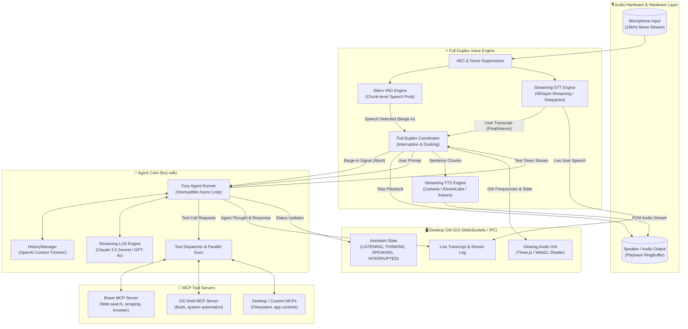

# Rose: Full-Duplex Voice & Desktop GUI Assistant Architecture Plan

## 1. Executive Summary & Vision
**Rose** is a low-latency, full-duplex voice companion and autonomous desktop assistant inspired by Huw Prosser's AI agent architecture (using `fury-sdk` runner patterns) and modern conversational AI benchmarks.

Rose enables fluid human-computer interaction:
- **Zero awkward turn-taking:** Full-duplex interruption via continuous Voice Activity Detection (Silero VAD) and acoustic echo cancellation.
- **Agentic Core:** Built on `fury-sdk` Runner pattern, handling streaming tokens, tool announcements (*"Checking Brave search..."*), parallel tool executions, and instant interruption cancellation tokens.
- **Desktop Companion GUI:** A high-framerate, glowing 3D/Canvas audio-reactive sound orb, real-time speech transcript stream, tool inspection timeline, and system telemetry widget.
- **Ecosystem Extensibility:** Native Model Context Protocol (MCP) clients connecting Rose to web navigation (Brave MCP), local system execution (OS Shell MCP), workspace files, and audio/visual peripherals.

---

## 2. High-Level Architecture Diagram



---

## 3. Voice Pipeline: Streaming & Full-Duplex Interruption

### 3.1 Voice Activity Detection (VAD) & Barge-In
- **Model:** Silero VAD v5 (ONNX runtime) executing every 32ms (512 samples @ 16kHz).
- **Acoustic Echo Cancellation (AEC):** Internal playback reference loop prevents Rose's own TTS output from triggering barge-in.
- **Barge-in Threshold:** When user speech probability $> 0.75$ for consecutive chunks (exceeding 160ms hangover duration) while Rose is in state `SPEAKING` or `THINKING`:
  1. Instant `ABORT_SIGNAL` broadcasted to Fury Agent Runner.
  2. TTS buffer cleared and audio playback pipeline flushed immediately ($< 30\text{ms}$).
  3. Frontend GUI transitions orb animation to `INTERRUPTED` pulse.
  4. Audio router captures speech buffer starting 150ms before trigger (pre-roll buffer) to prevent missing the first syllable.

### 3.2 Speech-to-Text (STT)
- **Primary Streaming STT:** Deepgram Nova-2 WebSockets or local Faster-Whisper / Whisper-Streaming with Silero chunk segmentation.
- **Output:** Emits interim hypothesis tokens (for real-time GUI display) and committed final transcripts (for Agent prompt dispatch).

### 3.3 Text-to-Speech (TTS)
- **Engine:** Low-latency streaming TTS (Cartesia Sonic API / ElevenLabs Websocket / local Kokoro-ONNX).
- **Chunking Strategy:** First chunk dispatched immediately upon encountering punctuation (`,`, `.`, `?`, `!`, `\n`) or at 6-8 words minimum to achieve $< 250\text{ms}$ Time-to-First-Audio.
- **Audio Output:** Streamed into a low-latency PCM audio ring buffer (e.g. `sounddevice` or `miniaudio`).

---

## 4. Agent Core: Fury SDK & MCP Architecture

### 4.1 Fury Runner Pattern
Huw Prosser's `fury-sdk` provides an interruptible runner abstraction:
- **`Agent` & `Runner` Integration:** Uses async execution pipelines where every generation step yields tokens and checks an `asyncio.Event` cancellation token.
- **Tool Announcements:** Before triggering long-running external tools, the runner yields speech announcements (e.g., *"Let me search the web for that"*), allowing the user to hear progress or interrupt early.
- **Context Management:** `HistoryManager` maintains an append-only JSON session log with dynamic token counting, pruning older message pairs while preserving system prompt and active tool call responses.

### 4.2 Tool Dispatch & Parallel Execution
- Implements parallel tool execution using `asyncio.gather`.
- Handles tool execution timeouts and fallback formatting for graceful agent recovery.

### 4.3 MCP (Model Context Protocol) Integration
Rose connects as an MCP Client over stdio and HTTP/SSE transports:
1. **Brave Search MCP:** Enables live web searching, snippet retrieval, and page inspection.
2. **OS Shell MCP:** Executes bash commands, checks processes, manages files, and inspects desktop state with security allowlists and execution safety guards.
3. **Desktop Automation MCP:** Integrates mouse/window manipulation and screenshot inspection for visual grounding.

---

## 5. Desktop GUI: Animated Voice Orb & Transcripts

### 5.1 Technology Stack
- **Frontend Container:** Lightweight Electron or Tauri / Modern Webview window with transparent background and frameless window styling (`alwaysOnTop` toggleable).
- **Orb Rendering:** Three.js / WebGL with custom GLSL vertex and fragment noise shaders (Simplex Noise / Perlin Displacement).
- **Communication:** Local WebSocket server (`ws://127.0.0.1:8765`) streaming state, audio frequency spectrum data (FFT 64-bins), and chat logs.

### 5.2 Orb States & Visual Dynamics
| State | Orb Visual Behavior | Color Palette |
| :--- | :--- | :--- |
| `IDLE` | Slow ambient breathing pulsation (0.2 Hz) | Soft Indigo / Cyan glow (`#4f46e5`) |
| `LISTENING` | Expands slightly, reacts smoothly to microphone RMS | Vibrant Cyan / Electric Blue (`#06b6d4`) |
| `THINKING` | Concentric spinning particle rings, swirling vortex | Radiant Violet / Magenta (`#a855f7`) |
| `SPEAKING` | High-frequency vertex displacement synced to TTS FFT | Deep Rose / Crimson Gold (`#f43f5e`, `#fbbf24`) |
| `INTERRUPTED` | Rapid contraction and chromatic ripple flash | Amber / Orange (`#f59e0b`) |

### 5.3 Transcript & Status Panel
- **Collapsible Drawer:** Slides out from the orb to reveal the live conversation feed, thought process traces, and tool execution badges.
- **Audio Waveform:** Real-time mini waveform bar at the base of the orb.

---

## 6. Project Directory & File Structure

```text
/home/pranc/projects/rose/
├── PLAN.md                     # Architecture plan (this document)
├── pyproject.toml              # Python package configuration (Poetry / Hatch / uv)
├── README.md                   # Overview & quickstart guide
├── configs/
│   ├── config.default.yaml     # Default configuration (audio, models, keys)
│   └── mcp_servers.json        # MCP server connection definitions
├── src/
│   └── rose/
│       ├── __init__.py
│       ├── main.py             # Application entrypoint & coordinator
│       ├── core/               # Fury SDK Agent Core
│       │   ├── __init__.py
│       │   ├── agent.py        # Fury Agent subclass & runner wrapper
│       │   ├── history.py      # Conversation history & context pruner
│       │   ├── dispatcher.py   # Tool registry & announcement handler
│       │   └── prompts.py      # System prompts & persona guidelines
│       ├── voice/              # Full-Duplex Audio & Speech Pipeline
│       │   ├── __init__.py
│       │   ├── audio_io.py     # Microphone & speaker PCM ring buffers
│       │   ├── vad.py          # Silero VAD barge-in detector
│       │   ├── stt.py          # Streaming STT client
│       │   ├── tts.py          # Low-latency streaming TTS client
│       │   └── duplex.py       # Interruption controller & state machine
│       ├── mcp/                # MCP Client Subsystem
│       │   ├── __init__.py
│       │   ├── client.py       # Multi-server MCP client manager
│       │   └── adapters.py     # Schema converters for fury tool calls
│       └── server/             # IPC & WebSocket Bridge
│           ├── __init__.py
│           ├── ws_server.py    # WebSocket broadcaster for GUI
│           └── events.py       # Standard event definitions
├── gui/                        # Desktop Orb Frontend
│   ├── index.html              # Main transparent viewport
│   ├── package.json            # GUI dependencies
│   ├── src/
│   │   ├── main.js             # Window bootstrap & WS client
│   │   ├── orb.js              # Three.js glowing shader orb
│   │   ├── audio_visualizer.js # FFT audio reactivity
│   │   ├── transcript.js       # Live transcript stream & tool badges
│   │   └── styles.css          # Frameless transparent layout
└── tests/
    ├── test_vad.py             # Audio VAD & interruption tests
    ├── test_fury_runner.py     # Fury SDK agent & tool cancellation tests
    └── test_mcp_client.py      # MCP tool connection tests
```

---

## 7. Implementation Roadmap & Phases

### Phase 1: Core Foundation & Fury Integration
- Set up project dependencies (`fury-sdk`, `pydantic`, `websockets`, `sounddevice`, `numpy`, `onnxruntime`).
- Implement `rose.core.agent` using `fury-sdk`'s `Agent` and `Runner` patterns.
- Connect streaming LLM client with abortable token generation.

### Phase 2: Full-Duplex Audio Pipeline
- Implement `audio_io.py` for continuous non-blocking microphone recording and speaker playback.
- Implement `vad.py` with Silero ONNX for real-time speech probability analysis.
- Connect streaming STT and streaming TTS, integrating `duplex.py` state machine to handle clean barge-in interruption.

### Phase 3: MCP Tool Integration (Brave & Shell)
- Implement `rose.mcp.client` to connect to Brave Search MCP and OS Shell MCP via stdio transport.
- Wrap MCP tools into Fury-compatible tool definitions with tool announcement support.
- Validate parallel tool execution and error handling.

### Phase 4: Desktop Sound Orb GUI
- Build Three.js custom vertex/fragment shader glowing orb.
- Establish WebSocket bridge between Python core and desktop GUI for state, FFT, and transcripts.
- Package into frameless transparent overlay window.

### Phase 5: End-to-End Tuning & Polish
- Tune latency benchmarks (target $< 350\text{ms}$ voice-to-voice response, $< 50\text{ms}$ barge-in cut-off).
- Refine system personality, interruption smoothness, and visual feedback states.
