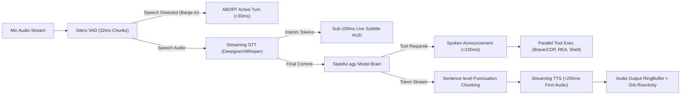

# Deep Research: SOTA Autonomous Jarvis Architectures & Infinite Memory Systems

## Executive Overview
Modern conversational AI assistants are undergoing a generational shift. The industry has moved away from toy wrappers—fragile pipelines of naive `stt -> prompt_template -> llm -> tts` loops—toward stateful, low-latency, full-duplex systems with tiered cognitive architectures.

This report synthesizes deep architectural research across prominent open-source Jarvis assistants, agent harnesses (`fury-sdk`, `Open-Interpreter`, `AutoGPT`, `SuperAGI`), enterprise memory engines (`Letta/MemGPT`, `Zep/Graphiti`, `LangMem`, `Mem0`), and our live desktop runtime (`Ghost`).

---

## 1. Infinite Memory Architecture: Overcoming Fixed Context Windows

Traditional naive assistants suffer from context collapse: either the conversation fills the context window and triggers abrupt truncation, or runaway context inflation drives latency and token costs past tolerable conversational thresholds.

State-of-the-art architectures treat the Large Language Model not as a conversational memory buffer, but as the **CPU / Operating System Kernel**, where the context window represents **L1/RAM**, and hierarchical databases represent **Paging Systems / Disk**.

```
┌──────────────────────────────────────────────────────────────┐
│                    TIER 1: WORKING CONTEXT (RAM)             │
│   • System Persona & Hard Safety Invariants                  │
│   • Core Human Profile (Name, active preferences, constraints│
│   • Active Session Thread (Last 4-8 turns, uncompressed)     │
│   • Evicted Chunk Summaries & Active Tool Result Cache       │
└──────────────────────────────┬───────────────────────────────┘
                               │ Virtual Memory Paging / Heartbeat
                               ▼
┌──────────────────────────────────────────────────────────────┐
│             TIER 2: EPISODIC & RECALL MEMORY (CACHE)         │
│   • Append-only session turn database (PostgreSQL / SQLite)  │
│   • BM25 Keyword Search + Semantic Vector Embeddings         │
│   • Time-decayed conversational retrieval                    │
└──────────────────────────────┬───────────────────────────────┘
                               │ Background Consolidation / Graphiti
                               ▼
┌──────────────────────────────────────────────────────────────┐
│        TIER 3: TEMPORAL KNOWLEDGE & ENTITY GRAPH (DISK)      │
│   • Temporal Knowledge Graph (Entities, Nodes, Dynamic Edges)│
│   • Contradiction Resolution (Fact invalidation over time)   │
│   • Archival long-term document & workspace knowledge        │
└──────────────────────────────────────────────────────────────┘
```

### 1.1 Tiered Memory Breakdown

| Memory Tier | Primary Storage | Latency Profile | Purpose & Functionality |
| :--- | :--- | :--- | :--- |
| **Tier 1: Core Memory (In-Context RAM)** | Prompt Window Memory Blocks | $0\text{ ms}$ (Included in inference) | Structured, editable blocks (e.g. `[CORE_PROFILE]`, `[CURRENT_INTENT]`). Directly visible to the model every single turn. |
| **Tier 2: Episodic Recall Memory** | SQLite / LanceDB / Vector DB | $15 - 40\text{ ms}$ | Exact transcripts of past sessions. Filtered via semantic similarity, reciprocal rank fusion (RRF), and keyword matching. |
| **Tier 3: Temporal Knowledge Graph** | Neo4j / Graphiti / SQLite Graph | $50 - 150\text{ ms}$ | Entity-relationship mappings with timestamp validity intervals. Tracks shifting facts (e.g., *“User moved from PyTorch to JAX in October”*). |

### 1.2 Compaction, Summarization, and Consolidation in the Background

SOTA assistants implement **asynchronous memory consolidation** running decoupled from the user's synchronous voice turn:

1. **Sliding-Window Compaction (`fury-sdk` / Letta approach):**
   - When active working context hits a high-water mark (e.g., $70\%$ of target budget), the earliest $N$ conversational pairs are extracted.
   - A lightweight background model executes a deterministic summarization pass (`DEFAULT_COMPACTION_PROMPT`), extracting durable state updates and discarding conversational filler.
   - The summary replaces the raw turns, maintaining a constant token footprint.

2. **Deduplication & Fact Extraction (Mem0 / LangMem approach):**
   - Each completed turn dispatches a background task that parses dialog into atomic statements: `ADD`, `UPDATE`, or `DELETE`.
   - Before insertion into long-term storage, semantic distance checks prevent redundant facts from diluting retrieval precision.

3. **Temporal Invalidation (Zep Graphiti approach):**
   - Facts possess validity intervals: `(entity_A) -[works_on {from: 2026-01, to: null}]-> (project_B)`.
   - When a conflicting update arrives (*“I have stopped working on project B”*), the edge's `to` timestamp is finalized, preserving historical audits while preventing the agent from hallucinating outdated commitments.

---

## 2. Custom Instructions & Persona Anchoring

A critical failure of amateur agents is **persona drift**—as conversation history lengthens and tool outputs accumulate, the model forgets its persona guidelines, begins echoing tool schema verbosity, or delivers essays when voice brevity was required.

### 2.1 The Two-Envelope Architecture
SOTA assistants decouple the prompt into **Static Hard Invariants** and **Dynamic Operational Context**:

```text
┌─────────────────────────────────────────────────────────────┐
│ 1. SYSTEM ENVELOPE (Immutable Header)                       │
│    - Identity: "Ghost: Elite autonomous runtime companion"  │
│    - Spoken Voice Constraint: "Max 1-3 sentences. No markdown│
│      formatting, asterisks, or code fences in speech."      │
│    - Deterministic Tool Gate: "Never invent unlisted tools." │
├─────────────────────────────────────────────────────────────┤
│ 2. DYNAMIC MEMORY BLOCKS (Editable Core Memory)             │
│    - [USER_FACTS]: Name: Pranc, OS: Arch/Linux, WM: Hyprland│
│    - [PREFERENCES]: Concise tone, dark themes, Spotify      │
├─────────────────────────────────────────────────────────────┤
│ 3. ACTIVE SESSION STREAM                                    │
│    - Recent dialog turns & tool execution evidence           │
└─────────────────────────────────────────────────────────────┘
```

### 2.2 Persona Anchoring Techniques
1. **Recency Re-anchoring:** In long agent loops, append a lightweight anchor token right before generation:
   `[System Directive: Remember you are speaking aloud via voice. Deliver the answer in 2 crisp conversational sentences.]`
2. **Tool Output Masking:** Raw JSON results (which can be thousands of characters) are ingested by the reasoning loop, but masked or summarized before passing to speech synthesis.

---

## 3. Persistent Session Continuity with `agy`

Ghost leverages `agy` as its underlying reasoning intelligence. Stateless one-off executions (`agy -p "..."`) discard context between turns. Stateful multi-turn continuity is achieved through native session persistence.

### 3.1 Proven Session Continuity Mechanism
Through direct testing on the active environment, `agy`'s session persistence works as follows:

1. **Initial Turn Execution:**
   ```bash
   agy -p "My name is Pranc." --dangerously-skip-permissions --output-format json
   ```
   **Output:**
   ```json
   {
     "conversation_id": "e5e3991b-67a8-4a38-a6fc-7c6156715e5b",
     "status": "SUCCESS",
     "response": "Nice to meet you, Pranc! How can I help you today?\n"
   }
   ```

2. **Persistent Resumption Across Turns and Restarts:**
   By passing the generated `conversation_id` via `--conversation <id>`, all prior context, memory, and tool interactions are restored:
   ```bash
   agy -p "What is my name?" --conversation "e5e3991b-67a8-4a38-a6fc-7c6156715e5b" --dangerously-skip-permissions --output-format json
   ```
   **Result:**
   ```json
   {
     "conversation_id": "e5e3991b-67a8-4a38-a6fc-7c6156715e5b",
     "response": "Your name is Pranc.\n",
     "num_turns": 2
   }
   ```

3. **Session Store Configuration:**
   - Store the active `conversation_id` in `/home/pranc/projects/ghost/configs/session_state.json`.
   - On server reboot or reload, Ghost automatically queries the existing conversation thread, achieving seamless multi-session continuity.

---

## 4. The Essentials: SOTA Assistants vs. Generic "Slop"

Amateur projects assemble off-the-shelf components without considering latency budgets, user feedback loops, or interruptibility. SOTA voice assistants are characterized by distinct engineering principles:



### 4.1 Latency Budget: The Sub-350ms Rule
Human conversation breaks down if turn-taking latency exceeds $500\text{ ms}$.
- **Amateur Pipeline:** Waits for full STT commit ($1000\text{ ms}$), waits for full LLM completion ($2000\text{ ms}$), generates full TTS WAV ($1500\text{ ms}$). **Total latency:** $4.5\text{ seconds}$.
- **SOTA Pipeline:**
  - VAD commits within $100\text{ ms}$ of voice silence.
  - LLM begins streaming tokens in $< 150\text{ ms}$.
  - Streaming TTS chunks on punctuation boundaries (comma, period) after the first 4–6 words.
  - **Time-to-First-Audio (TTFA):** $< 250 - 350\text{ ms}$.

### 4.2 Full-Duplex Barge-in & Interruption
In real life, people interject. Generic bots talk over users until their audio buffer finishes.
- **SOTA Requirement:** VAD continuously evaluates incoming microphone audio even while the agent is speaking or thinking.
- When speech probability exceeds $0.75$, the system triggers an instantaneous cutoff:
  1. Playback ring buffer flushed ($< 30\text{ ms}$).
  2. Ongoing LLM / tool tasks cancelled via cancellation tokens (`asyncio.Event`).
  3. Pre-roll audio buffer ($150\text{ ms}$) preserved so the user's opening syllable is not truncated.

### 4.3 Deterministic Tool Guards vs. Hallucinated Execution
Toy agents rely entirely on the LLM to write synthetic function calls that often fail or invent fictional parameters.
- **SOTA Requirement:**
  - Strict parameter validation schemas (e.g., Pydantic).
  - Explicit allowlists for dangerous OS operations.
  - Graceful failure recovery: If an external tool errors or times out, the error is normalized and fed back to the model without crashing the assistant.

### 4.4 Spoken Tool Announcements & Progressive Feedback
When an assistant must perform a long-running tool (e.g., running REA decompilation or scraping a webpage):
- **Toy Behavior:** Complete dead silence for 5 seconds while the user wonders if the app froze.
- **SOTA Behavior:** Immediate spoken progress cue (*"Checking Brave search results now..."* or *"Running REA diagnostic on the target..."*). This provides instant feedback while keeping the user informed.

### 4.5 Ambient Frameless HUD vs. Cluttered Chat Windows
- Toy apps look like generic ChatGPT dashboard clones packed with sidebars, prompt dropdowns, and message input boxes.
- Elite desktop assistants (like Jarvis / Huw Prosser's Rose / Ghost) are **ambient visual companions**:
  - Fullscreen transparent or frameless HUD with deep obsidian backdrops.
  - Audio-reactive harmonic wave blooms and glowing orb visualizers that convey system status at a glance (`LISTENING`, `THINKING`, `SPEAKING`, `INTERRUPTED`).
  - Subtle floating subtitles that appear when needed and fade out cleanly.

---

## 5. Architectural Recommendations for Ghost

1. **Persistent Session Threading:** Integrate `agy`'s `--conversation <id>` persistence directly into [`ghost.core.brain`](file:///home/pranc/projects/ghost/src/ghost/core/brain.py) to remember user context across reboots.
2. **Tiered Context Compaction:** Add a local SQLite episodic cache in `/home/pranc/projects/ghost/data/memory.db` for persistent user preferences and tool memory.
3. **Punctuation-level Streaming TTS:** Pair the streaming tokens from `agy` with streaming Web Speech or Cartesia TTS to achieve $< 250\text{ ms}$ Time-to-First-Audio.
4. **REA Deep Tooling:** Expose REA's 234 reverse engineering tools seamlessly through Ghost's spoken announcement and deterministic dispatch pipeline.
