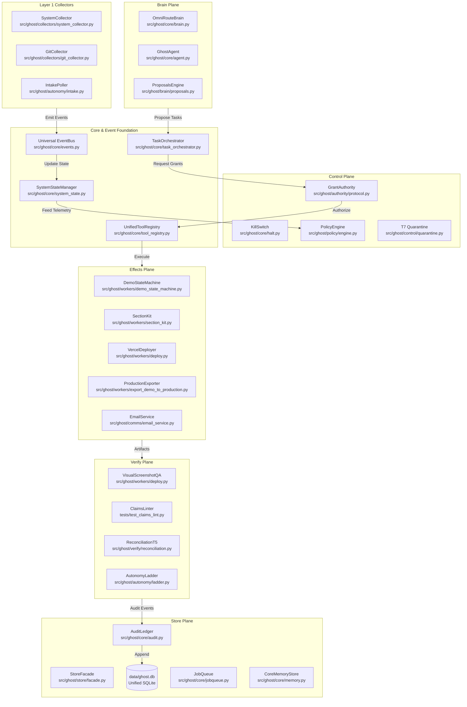

# GHOST SYSTEM COMPONENT MAP
**Document:** `SYSTEM_COMPONENT_MAP.md`  
**Status:** AUTHORITATIVE COMPONENT DIRECTORY & DEPENDENCY GRAPH  
**Version:** 1.0  
**Date:** 2026-11-10  
**Working Directory:** `/home/pranc/projects/ghost`  

---

## 1. System Planes & Component Topology

---

## 2. Component Directory & Interface Specifications

### 2.1 Core & Infrastructure Subsystems

#### `Universal EventBus` ([`src/ghost/core/events.py`](file:///home/pranc/projects/ghost/src/ghost/core/events.py))
- **Plane:** Core Foundation (Layer 2)
- **Responsibility:** Typed event ingestion, deduplication, SQLite WAL backing in `ghost.db`, and in-memory pub/sub distribution.
- **Inputs:** `Event` objects emitted by collectors, agents, or API endpoints.
- **Outputs:** Asynchronous event delivery to registered subscribers.
- **Lifecycle:** Boots during server/runtime startup; runs until application shutdown.
- **Failure Recovery:** Subscriber errors are isolated in `try...except` blocks; failing events route to dead-letter storage without crashing peer subscribers.

#### `SystemStateManager` ([`src/ghost/core/system_state.py`](file:///home/pranc/projects/ghost/src/ghost/core/system_state.py))
- **Plane:** Core Foundation (Layer 3)
- **Responsibility:** Thread-safe in-memory cache of live hardware metrics, running tasks, connected integrations, and active window titles.
- **Inputs:** Telemetry samples from `SystemCollector`, status updates from `JobQueue`.
- **Outputs:** Immutable `StateSnapshot` dictionaries for the GUI HUD, Policy Engine, and Agent contexts.
- **Concurrency:** Guarded by `asyncio.Lock` for atomic reads and writes.

#### `UnifiedToolRegistry` ([`src/ghost/core/tool_registry.py`](file:///home/pranc/projects/ghost/src/ghost/core/tool_registry.py))
- **Plane:** Core Foundation (Layer 7)
- **Responsibility:** Central registry for all 14+ tools, separating JSON parameter schemas, permission requirements, side-effect assertions, and execution handlers.
- **Inputs:** Tool invocation requests with arguments and optional capability grant token.
- **Outputs:** Structured execution receipts and verified output artifacts.
- **Security Check:** Asserts `grant_token` validity via `authority/protocol.py` for all outbound effect tools before execution.

#### `TaskOrchestrator` ([`src/ghost/core/task_orchestrator.py`](file:///home/pranc/projects/ghost/src/ghost/core/task_orchestrator.py))
- **Plane:** Central Orchestrator (Layer 5)
- **Responsibility:** Manages objectives and enforces the 11-state task state machine.
- **Inputs:** Objectives submitted via chat, scheduled jobs, or event-driven rules.
- **Outputs:** Atomic task state transitions persisted to SQLite `jobs` table in `ghost.db`.

---

### 2.2 Authority, Policy & Security Subsystems

#### `GrantAuthorityProtocol` ([`src/ghost/authority/protocol.py`](file:///home/pranc/projects/ghost/src/ghost/authority/protocol.py))
- **Plane:** Control Plane (Layer 2)
- **Responsibility:** Issues and verifies single-use HMAC-SHA256 capability tokens (`grant_token`).
- **Secret Isolation:** Uses `GHOST_GRANT_SECRET` from environment; never exposes secret keys to worker contexts.
- **Revocation:** Validates that token epoch matches `data/REVOCATION_EPOCH`. Any halt or epoch bump instantly invalidates all outstanding tokens.

#### `PolicyEngine` ([`src/ghost/policy/engine.py`](file:///home/pranc/projects/ghost/src/ghost/policy/engine.py))
- **Plane:** Control Plane (Layer 4)
- **Responsibility:** Evaluates declarative business bounds (`configs/policy.json`) before outbound actions.
- **Rules Enforced:** Max new contacts per day, allowed business hours, minimum deal value, spend limits.

#### `T7 Quarantine` ([`src/ghost/control/quarantine.py`](file:///home/pranc/projects/ghost/src/ghost/control/quarantine.py))
- **Plane:** Control Plane (Layer 2)
- **Responsibility:** Sanitizes external customer emails and web lead forms to prevent prompt injection attacks before text enters LLM context or CRM storage.

---

### 2.3 Specialized Production Workers

#### `AutonomousDemoStateMachine` ([`src/ghost/workers/demo_state_machine.py`](file:///home/pranc/projects/ghost/src/ghost/workers/demo_state_machine.py))
- **Plane:** Effects Plane (Layer 3)
- **Responsibility:** Executes the 5-phase demo generation process for local luxury businesses.
- **Phases:**
  1. *Recon & Extraction:* Scrapes Google Maps gallery photos via Brave CDP.
  2. *Design Brief:* Compiles design tokens and section plan into `DESIGN_BRIEF.md`.
  3. *Sectional Composition:* Composes responsive HTML via Section Kit; enforces domain vocabulary linter; stages serverless stubs.
  4. *Visual Verification:* Headless Brave CDP screenshot audit (390x844 & 1440x900) with offline DOM QA fallback.
  5. *Handover:* Deploys to Vercel and prepares personalized outreach pitch kit.

#### `SectionKit` ([`src/ghost/workers/section_kit.py`](file:///home/pranc/projects/ghost/src/ghost/workers/section_kit.py))
- **Plane:** Effects Plane (Layer 3)
- **Responsibility:** Composes complete landing pages from 13 pre-validated component templates (`templates/sections/`).
- **Photo Doctrine:** Enforces that real photos with SHA-256 provenance are used. If photos are absent, strictly falls back to typography-first styling.

#### `ProductionExporter` ([`src/ghost/workers/export_demo_to_production.py`](file:///home/pranc/projects/ghost/src/ghost/workers/export_demo_to_production.py))
- **Plane:** Effects Plane (Layer 3)
- **Responsibility:** Compiles approved static HTML demos into complete Next.js 14 App Router codebases ready for client handoff.
- **Outputs:** `package.json`, `tailwind.config.ts`, `app/page.tsx`, `app/api/contact/route.ts`, `public/assets/`, `README.md`.

---

### 2.4 Persistence & Memory Subsystems

#### `UnifiedStoreFacade` ([`src/ghost/store/facade.py`](file:///home/pranc/projects/ghost/src/ghost/store/facade.py))
- **Plane:** Store Plane (Layer 5)
- **Responsibility:** Directs all database calls into `data/ghost.db` under WAL mode.
- **Legacy Compatibility:** Seamlessly emulates legacy per-feature database paths when unified mode is disabled.

#### `CoreMemoryStore` ([`src/ghost/core/memory.py`](file:///home/pranc/projects/ghost/src/ghost/core/memory.py))
- **Plane:** Store Plane (Layer 8)
- **Responsibility:** Manages user preferences, behavioral directives, and verified profile facts in `configs/directives.json`.
- **Contradiction Guard:** Performs semantic contradiction checks; if a contradiction occurs, preserves both facts with conflict flags rather than silently deleting history.
