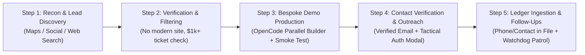
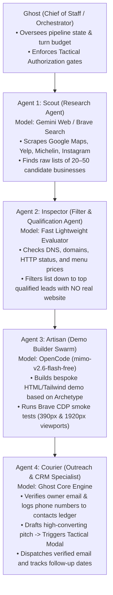

# AGENCY MULTI-AGENT SPECIFICATION & OPERATIONAL PIPELINE
**Document:** `agents.md`  
**Director:** Ghost (Chief of Staff & Agency Technical Operations Director)  
**Goal:** High-Conversion Hospitality & Luxury Business Client Acquisition ($1,000+ Deals)  
**Architecture:** 4 Specialized Sub-Agents + Central Director + Ground Truth CRM  

---

## 1. The 5-Step Pipeline Lifecycle

1. **Step 1: Research & Discovery:** Scan designated regions/cities for high-end hospitality, boutique stays, and fine dining.
2. **Step 2: Filtration & Viability Gate:** Filter down to businesses that have *no website* (or only broken/PDF links or basic social pages) and command high average ticket sizes ($50+ per cover or $200+/night).
3. **Step 3: High-End Demo Generation:** Scaffold single-page luxury demos matching one of the 4 Archetypes, enforcing strict component standards and automated Brave CDP smoke tests.
4. **Step 4: Decision-Maker Contact & Verified Pitch:** Find the direct manager/owner email, verify MX records/inbox syntax, draft a personalized email, and present to the user via Tactical Authorization Modal before sending.
5. **Step 5: Central Contact & Phone Ledger:** Record verified phone numbers, emails, addresses, and owner details into both `data/contacts.json` (and `data/contacts.csv`) and Obsidian Vault client notes.

---

## 2. Specialized Multi-Agent Roles (The 4-Agent Division)

Instead of a single agent doing everything, the pipeline is divided across 4 specialized sub-agents orchestrated by Ghost:

### Agent 1: Scout (Research & Discovery)
- **Role:** Deep web reconnaissance.
- **Tools:** `web_search`, `brave_cdp` (for Google Maps & Instagram scraping).
- **Output:** Raw lead manifest containing business name, city, location, social links, and Google Maps URL.

### Agent 2: Inspector (Filter & Lead Qualification)
- **Role:** Lead validation and disqualification gate.
- **Criteria for Pass:**
  1. *No existing custom website* (or domain is dead, unmaintained, or points to a Facebook page/PDF menu).
  2. *High ticket size* ($$$ or $$$$ rating, tasting menu >$60, or room rates >$150/night).
  3. *Active business* (reviews within the last 30–60 days).
- **Output:** Qualified batch list passed directly to Agent 3.

### Agent 3: Artisan (High-End Demo Builder Swarm)
- **Role:** Parallel demo production.
- **Engine:** OpenCode CLI (`opencode/mimo-v2.6-flash-free`), 2 builds concurrently.
- **Design Guidelines:** Follows the 4 Luxury Archetypes in `chief.md` (no stock AI buttons, mobile category pills, subtle 1px borders, high-end typography, lazy-loaded media).
- **Verification:** Headless Brave CDP smoke test to ensure 0 console errors and clean mobile responsiveness.
- **Output:** Local path: `/home/pranc/projects/ghost/demos/<slug>/index.html`.

### Agent 4: Courier (Outreach & Contact Ledger Specialist)
- **Role:** Decision-maker contact extraction, ledger maintenance, and outreach.
- **Contact Ledger:** Automatically appends business name, decision-maker name, phone number, email, and social handles into:
  - Central CSV: `/home/pranc/projects/ghost/data/contacts.csv`
  - Central JSON: `/home/pranc/projects/ghost/data/contacts.json`
  - Obsidian Vault: `/home/pranc/Obsidian Vault/Ghost/Clients/<slug>.md`
- **Email Verification & Sending:**
  - Validates email format and domain MX record.
  - Generates personalized pitch referencing specific dishes/ambiance.
  - Pops the desktop **Tactical Authorization Modal** (`[✓ ALLOW]` / `[✕ DENY]`).
  - Upon approval, dispatches via authenticated SMTP (`pranav31207@gmail.com`) and sets follow-up timer (48–72h) in Watchdog.

---

## 3. How Agents Are Made & How They Work (Short Summary)

1. **How We Make Them:**
   - We implement each agent as an isolated Python class/worker in `src/ghost/workers/` (e.g., `scout.py`, `inspector.py`, `artisan.py`, `courier.py`).
   - Each worker has a narrow, dedicated prompt, a strict input/output JSON schema, and only the tools it needs (Scout gets web search; Artisan gets OpenCode + Brave CDP; Courier gets IMAP/SMTP + Contacts ledger).

2. **How They Work Together:**
   - Ghost (the Director) acts as the queue manager. Ghost passes the output of Agent 1 $\rightarrow$ Agent 2 $\rightarrow$ Agent 3 $\rightarrow$ Agent 4.
   - None of the sub-agents talk to each other directly or burn context. They write structured JSON outputs to `data/pipeline/<batch_id>/`, preserving Ghost’s tokens and eliminating hallucinations.
   - When Agent 4 is ready to pitch, it hands the draft back to Ghost to trigger the desktop authorization modal for you.
