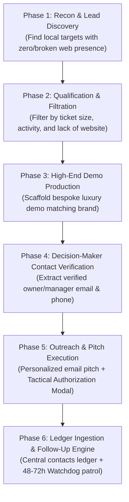

# AGENCY OPERATIONAL WORKFLOW & LIFECYCLE SPECIFICATION
**Document:** `flow.md`  
**Purpose:** End-to-End Execution Flow for Client Acquisition ($1,000+ Deals)  
**Status:** In Progress — Awaiting Commander Pranav's Input  

---

## 1. High-Level Flow Architecture

---

## 2. Phase Breakdown (Ready for Your Specific Steps)

### Phase 1: Research & Discovery (The Scout)
- **Objective:** Find candidate businesses in target cities/niches.
- *Your details here:*
  - [ ] Target sources (Google Maps, Instagram, Yelp, local directories):
  - [ ] Search query patterns:
  - [ ] Initial data points extracted:

### Phase 2: Qualification & Filtering (The Inspector)
- **Objective:** Filter down to high-value businesses with no modern online presence.
- *Your details here:*
  - [ ] Website presence test (how to confirm no real website):
  - [ ] Pricing / ticket size threshold:
  - [ ] Activity / review recency check:
  - [ ] Disqualification criteria:

### Phase 3: Demo Engineering (The 5-Stage Autonomous State Machine)
- **HARD RULE:** Ghost is **STRICTLY HARDCODED** to use the local OpenCode worker (`demo_builder.py` with `mimo-v2.6-flash-free`) executing sequential state-machine stages for pre-contract bait demos. Never one-shot 300+ lines of raw code.
- **Objective:** Build a bespoke, single-page static HTML demo that wows the owner in under 4 seconds with 0 cloud token cost.

#### Stage 1: Recon & Brand Extraction (The Scraper Node)
- **Inputs:** Business Name & Location/Neighborhood.
- **Tools:** `web_search` and `brave_cdp` (Brave browser automation).
- **Extracted Intelligence:**
  1. Business Name & Exact Neighborhood.
  2. Core Offerings / Signature Dishes (top 3–5 items with descriptions).
  3. Real Customer Social Proof: Exactly 3 authentic 5-star review quotes from Google Maps/Yelp.
  4. Operating Hours & Direct WhatsApp/Phone reservation trigger.
  5. Archetype Classification (Michelin Dark, Coastal Minimalist, Heritage Luxury, Modern Bistro).

#### Stage 2: Generating `DESIGN_BRIEF.md` (Context Layering)
- Ghost generates a temporary `demos/<slug>/DESIGN_BRIEF.md` before writing a single line of markup:
  - Exact Tailwind palette tokens (background, surface, accent gold/amber/terracotta, text).
  - Editorial font pairing (e.g. *Playfair Display* / *Cinzel* header + *Plus Jakarta Sans* / *Space Grotesk* body).
  - Sectional blueprint: Hero $\rightarrow$ Bento Grid Features $\rightarrow$ Infinite Review Marquee $\rightarrow$ Oversized Typography Footer.

#### Stage 3: Sectional Component Building (Anti-Lazy Assembly)
To prevent LLM laziness (where models truncate after ~150 lines or write `// add more cards here`), Ghost builds modular sections sequentially:
1. **Shell & Global Styles (Light Mode Default + Dark Mode Switcher):**
   - The site renders in clean, high-end **Light Mode by default** (`#faf9f5` / `#ffffff`).
   - Includes a functional dark/light mode toggle button in the navigation header with `document.documentElement.classList.toggle('dark')`.
   - Injects Google Fonts, smooth scroll, subtle noise grain overlay (`pointer-events-none fixed inset-0 opacity-[0.03]`), and React Bits ambient gradient mesh.
2. **Hero:** Staggered entrance animation via Anime.js, luxury status badge (e.g., *"Serving Mayfair since 2018 • 4.9★ on Google"*), dual CTAs with Magic UI shimmer reservation button.
3. **BentoFeatures:** Asymmetric CSS Grid (`grid-cols-1 md:grid-cols-3` with a hero card spanning `md:col-span-2`) styled in KokonutUI liquid-glass cards with Motion spring hover easing.
4. **ProofAndReviews:** Seamless infinite horizontal CSS marquee featuring 3 real customer quotes and Bklit sommelier rating card.
5. **ConversionFooter:** High-impact oversized typography (`text-[10vw] leading-none tracking-tighter`) with direct WhatsApp & phone booking triggers.

#### Stage 4: Visual Self-Healing (Brave CDP Headless Verification)
- Ghost loads the generated demo locally via **Brave CDP** on port `9222`.
- Simulates mobile viewport (390x844) and desktop (1440x900).
- Verifies DOM hierarchy, checks image asset load states, and audits the browser console for 0 errors.
- If an unaligned grid or broken asset is detected, Ghost applies targeted section patches automatically.

#### Stage 5: Instant Preview & Handover
- Demos are hosted locally as a zero-cost offline preview (`demos/<slug>/index.html`) or published via Cloudflare Pages / Vercel CLI when configured.
- Watchdog pings Ghost to draft the personalized outreach pitch and present it to the user via the Tactical Authorization Modal.

---

### Phase 3.5: Production Delivery Engine ($1,000+ Closed Accounts Only)
- **Engine:** **Webstudio** (`https://github.com/webstudio-is/webstudio.git`)
- **Role:** Webstudio is the open-source visual website builder and CMS used **ONLY** after a contract is signed and payment is committed.
- **Why Webstudio for $1,000 Clients:**
  - Open-source, self-hostable Webflow alternative with modern React/Radix UI foundations.
  - Generates clean, zero-lock-in code that exports directly to Remix / Cloudflare / Vercel.
  - Gives the restaurant manager a visual dashboard to edit daily specials, hours, and menu pricing without needing developer support.

### Phase 4: Contact Discovery & Verification (The Courier)
- **Objective:** Secure the direct decision-maker's contact information.
- *Your details here:*
  - [ ] Finding the owner/GM name:
  - [ ] Email discovery & MX verification methods:
  - [ ] Phone number extraction:
  - [ ] Formatting for the central contacts ledger (`contacts.csv` / `contacts.json`):

### Phase 5: Cold Pitch & Outreach (The Closer)
- **Objective:** Send a high-converting, personalized pitch linking the demo.
- *Your details here:*
  - [ ] Pitch angle / value proposition:
  - [ ] Subject line style:
  - [ ] Demo presentation (screenshots, direct file, loom/screen video):
  - [ ] Tactical Authorization Gate parameters:

### Phase 6: Post-Pitch Follow-Up & CRM Lifecycle
- **Objective:** Track responses, handle objections, and close the contract.
- *Your details here:*
  - [ ] Response detection (IMAP Watchdog):
  - [ ] Follow-up schedule (Day 3, Day 7):
  - [ ] Alternate channel escalation (WhatsApp, Phone, Instagram DM):
  - [ ] Closing & contract handover:
